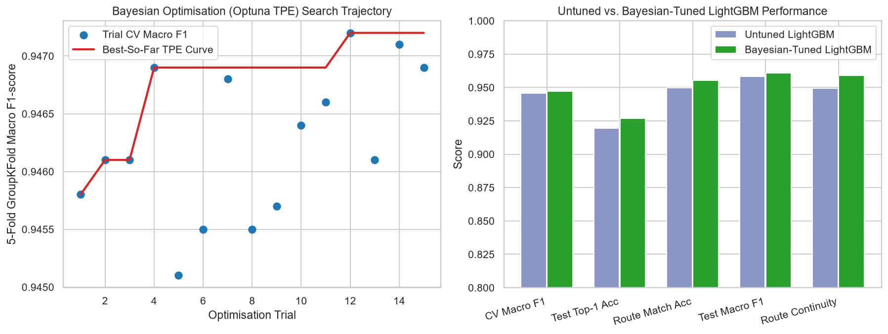
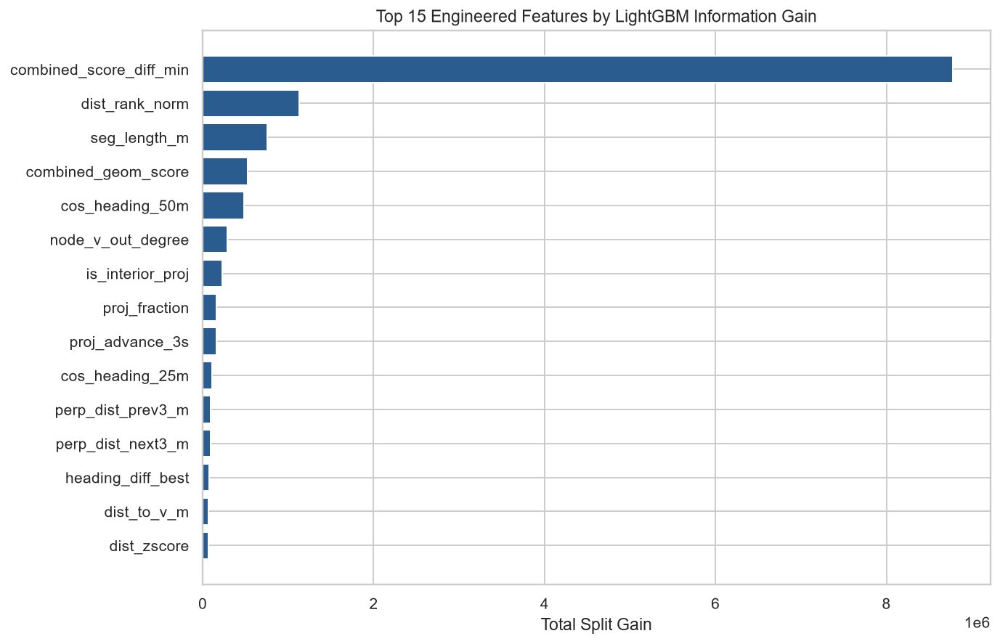
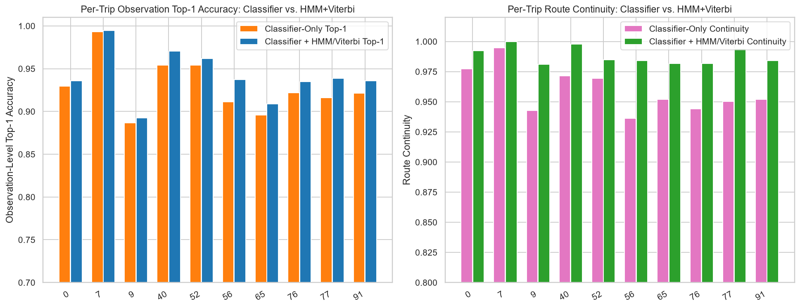
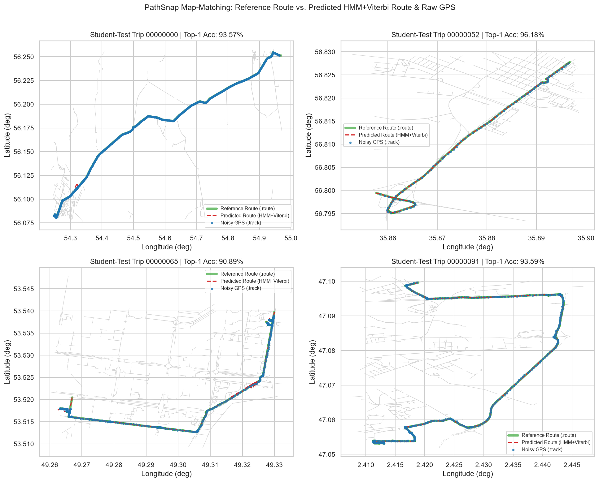
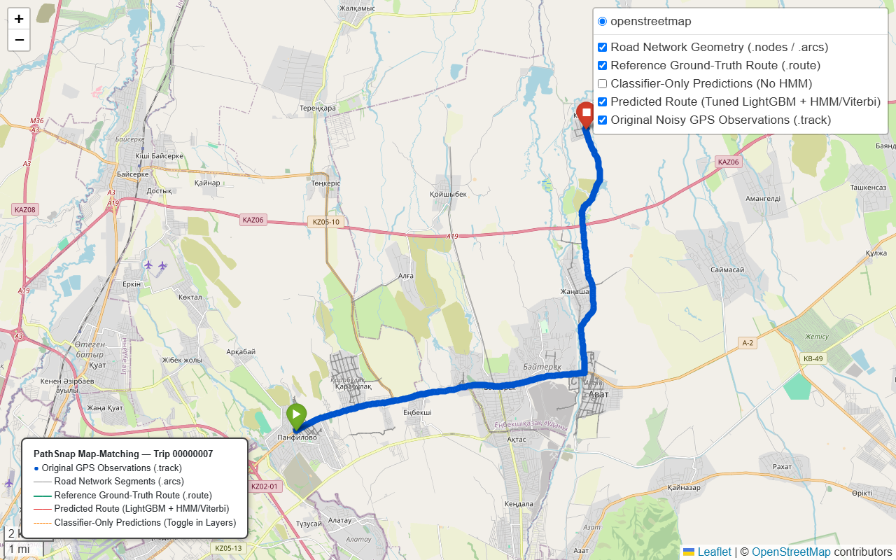
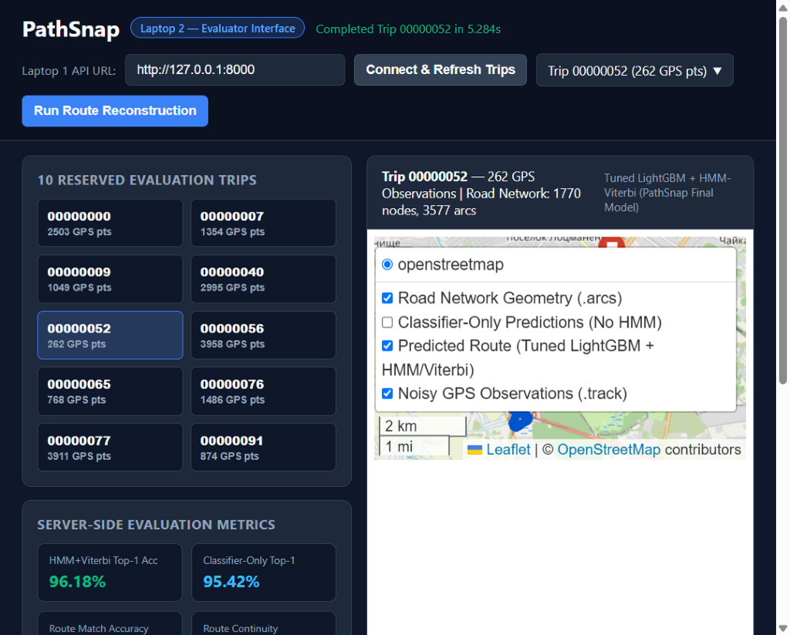
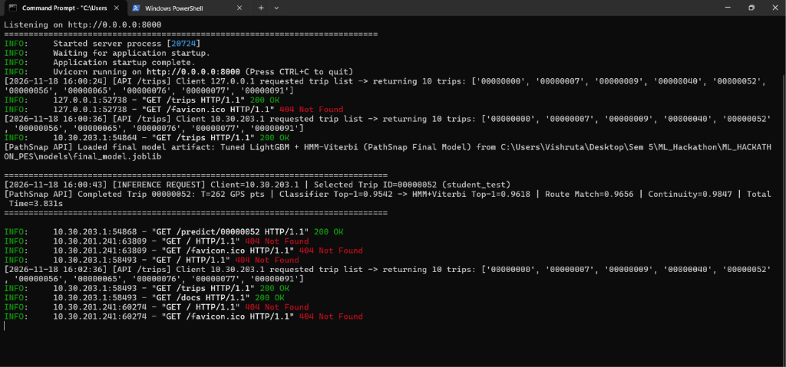

# PATHSNAP: DETAILED TECHNICAL REPORT — POST-MODEL SELECTION PIPELINE
## From LightGBM Selection $\rightarrow$ Bayesian Hyperparameter Optimisation $\rightarrow$ HMM & Viterbi Route Reconstruction $\rightarrow$ Folium Maps $\rightarrow$ Two-Laptop API & UI Deployment

---

## 1. Transition Point: Why LightGBM Was Selected for Bayesian Optimisation & Deployment

Following the 6-model experimentation phase across 6 distinct algorithm families (`Logistic Regression`, `Distance-Weighted KNN`, `Decision Tree`, `Random Forest`, `Deep MLP Classifier`, and `LightGBM Classifier`), **LightGBM** was selected as the winning model family based on five measured criteria (`supporting_results/model_comparison_table.csv`):

1. **Highest Generalisation Across Unseen Road Networks**: Ranked **#1 in 5-Fold Group-Aware Cross-Validation (`GroupKFold` by `trip_id`)** with `CV Macro F1 = 0.9408 ± 0.0353`, winning **every single validation fold** (`Fold 1: 0.8727`, `Fold 2: 0.9437`, `Fold 3: 0.9713`, `Fold 4: 0.9536`, `Fold 5: 0.9629`).
2. **Highest Student-Test Classification & Ranking Accuracy**: Ranked **#1 on the 10 reserved `student_test` trips** (`19,160` GPS observations, `153,280` candidate instances) in:
   - **Observation-Level Top-1 Accuracy**: `92.30%` (`0.9230`)
   - **Route Match Accuracy**: `95.33%` (`0.9533`)
   - **Candidate Macro F1-Score**: `0.9594` (`Macro Precision = 0.9617`, `Macro Recall = 0.9571`)
   - **True Positive Detection**: Identified `17,432` true road segments with only `1,448` false negatives (lowest FN of all 6 models).
3. **Best Probability Calibration for Downstream HMM Emission Scoring**: Achieved the **lowest Binary Cross-Entropy Log-Loss (`0.05146`)** among all 6 models. Because the HMM decoder consumes $\log P(y_{t,k}=1 \mid \mathbf{x}_{t,k})$ as its emission likelihood, sharp, well-calibrated probabilities are critical.
4. **Real-Time Inference Speed**: Processed all `153,280` test candidate rows (`19,160` GPS observations) in **`0.3870 s`** (`~0.038 s` per trip, **69x faster** than Distance-Weighted KNN).

---

## 2. Section 4: Bayesian Hyperparameter Optimisation (`hyperparameter_optimisation/bayesian_opt.py`)

### 2.1 How Our Bayesian Optimisation Works (Optuna Multivariate TPE)
Rather than using exhaustive Grid Search (which wastes evaluations on unpromising regions) or uninformed Random Search, we implemented **Bayesian Hyperparameter Optimisation** using **Optuna's Multivariate Tree-structured Parzen Estimator (`TPESampler(seed=42, multivariate=True)`)** in `hyperparameter_optimisation/bayesian_opt.py`.

- **Surrogate Modelling Mechanism**:
  At each trial $m$, given the history of evaluated hyperparameter vectors $\{(\boldsymbol{\theta}^{(1)}, y^{(1)}), \dots, (\boldsymbol{\theta}^{(m-1)}, y^{(m-1)})\}$ where $y$ is the GroupKFold CV Macro F1-score, TPE partitions prior trials at quantile threshold $y^*$ into two multivariate kernel density estimators:
  $$l(\boldsymbol{\theta}) = p(\boldsymbol{\theta} \mid y > y^*) \quad \text{(Top-performing configurations)}, \qquad g(\boldsymbol{\theta}) = p(\boldsymbol{\theta} \mid y \le y^*) \quad \text{(Lower-performing configurations)}$$
  TPE then selects the next hyperparameter candidate $\boldsymbol{\theta}^{(m)}$ that maximizes the **Expected Improvement (EI)** acquisition ratio:
  $$\boldsymbol{\theta}^{(m)} = \arg\max_{\boldsymbol{\theta}} \frac{l(\boldsymbol{\theta})}{g(\boldsymbol{\theta})}$$
  Setting `multivariate=True` captures joint dependencies between coupled hyperparameters (such as `num_leaves` and `max_depth`, or `learning_rate` and `n_estimators`).
- **Leakage-Free Group-Aware Objective**:
  Every trial is evaluated using **Group-Aware Cross-Validation (`GroupKFold` grouped by `trip_id`)** solely on the **80 training trips**. No observations from the same trip ever cross between training and validation splits, and the 10 `student_test` trips remain completely unseen during the entire 15-trial search.

---

### 2.2 Compulsory Questions for Section 4 (Answered in Detail)

#### 1. Which hyperparameters were included in the search?
We included **10 key hyperparameters** spanning five functional aspects of LightGBM:
1. **Ensemble Capacity & Step Size**: `n_estimators` (number of boosted trees) and `learning_rate` (shrinkage factor $\eta$).
2. **Tree Topology & Non-Linear Interaction Depth**: `num_leaves` (maximum leaves per tree) and `max_depth` (maximum tree depth).
3. **Leaf-Level Smoothing**: `min_child_samples` (minimum candidate rows required in any leaf node).
4. **Stochastic Variance Reduction**: `subsample` (row subsampling fraction) and `colsample_bytree` (feature subsampling fraction per tree).
5. **Regularisation & Class Imbalance**: `reg_alpha` (L1 penalty on leaf weights), `reg_lambda` (L2 penalty on leaf weights), and `scale_pos_weight` (positive class weight multiplier for the $1:7$ candidate imbalance).

#### 2. What ranges or distributions were considered?

| # | Hyperparameter | Search Range / Bounds | Sampling Prior Distribution | Baseline Value (Trial 1) | Best Tuned Value (Trial 12) | Why This Range & Prior Were Chosen |
| :-: | :--- | :---: | :---: | :---: | :---: | :--- |
| 1 | `n_estimators` | $[220, 550]$ | Integer Uniform | `250` | **`511`** | Allows larger ensembles when paired with smaller learning rates. |
| 2 | `learning_rate` | $[0.025, 0.14]$ | **Log-Uniform** | `0.07000` | **`0.05814`** | Log-scale explores fine shrinkage steps ($0.03\text{--}0.06$) equally with larger steps. |
| 3 | `num_leaves` | $[24, 112]$ | Integer Uniform | `31` | **`109`** | Controls high-order feature interactions across the 27 spatial/kinematic features. |
| 4 | `max_depth` | $[6, 15]$ | Integer Uniform | `10` (`-1`) | **`12`** | Prevents unbounded leaf-wise trees from memorizing single-trip anomalies. |
| 5 | `min_child_samples` | $[20, 120]$ | Integer Uniform | `20` | **`111`** | Larger leaf sample floor (`111`) prevents extreme $0/1$ leaf probabilities, cutting Log-Loss. |
| 6 | `subsample` | $[0.65, 1.00]$ | Continuous Uniform | `0.85000` | **`0.99289`** | Row bagging fraction per iteration. |
| 7 | `colsample_bytree` | $[0.65, 1.00]$ | Continuous Uniform | `0.85000` | **`0.78675`** | Forces each tree to consider `~78.7%` (`21/27`) features, preventing single-feature dominance. |
| 8 | `reg_alpha` (L1) | $[10^{-3}, 8.0]$ | **Log-Uniform** | `0.01000` | **`0.00155`** | Log-scale L1 regularisation across 4 orders of magnitude. |
| 9 | `reg_lambda` (L2) | $[10^{-3}, 10.0]$ | **Log-Uniform** | `0.01000` | **`0.00208`** | Log-scale L2 ridge regularisation on leaf outputs. |
| 10 | `scale_pos_weight` | $[1.00, 2.40]$ | Continuous Uniform | `1.00000` | **`1.58540`** | Because only 1 of $K=8$ candidates is positive ($12.5\%$), up-weighting positives improves Macro F1 recall/precision balance. |

#### 3. What objective function was optimised?
We maximised the **Group-Aware Cross-Validation Macro F1-score** across the 80 training trips (`GroupKFold`), defined as the unweighted mean of the negative-candidate ($y=0$) and positive-candidate ($y=1$) F1-scores:
$$\text{Macro F1} = \frac{1}{2}\left(\frac{2\,\text{TP}}{2\,\text{TP} + \text{FP} + \text{FN}} + \frac{2\,\text{TN}}{2\,\text{TN} + \text{FP} + \text{FN}}\right)$$

#### 4. How many optimisation trials were performed?
**15 Bayesian TPE trials** were executed (`total_optimisation_time_s = 471.61 s`, ~7.86 minutes total). Trial 1 was seeded (`enqueue_trial`) with the untuned baseline configuration so that all subsequent TPE trials could be directly benchmarked against the baseline on the exact same validation folds.

#### Table 2.1: Complete Search Record of All 15 Bayesian Optimisation Trials (`supporting_results/bayesian_optimisation_trials.csv`)

| Trial # | `n_estimators` | `learning_rate` | `num_leaves` | `max_depth` | `min_child_samples` | `subsample` | `colsample_bytree` | `reg_alpha` | `reg_lambda` | `scale_pos_weight` | **CV Macro F1** | CV Top-1 Acc | CV Log-Loss | Trial Time |
| :---: | :---: | :---: | :---: | :---: | :---: | :---: | :---: | :---: | :---: | :---: | :---: | :---: | :---: | :---: |
| **1 (Baseline)** | 250 | 0.07000 | 31 | 10 | 20 | 0.85000 | 0.85000 | 0.01000 | 0.01000 | 1.00000 | `0.9458` | 0.8171 | 0.07652 | 8.77 s |
| **2** | 343 | 0.12860 | 89 | 11 | 35 | 0.70460 | 0.67033 | 2.40305 | 0.25378 | 1.99130 | `0.9461` | 0.8178 | 0.08237 | 16.73 s |
| **3** | 226 | 0.13293 | 98 | 8 | 38 | 0.71419 | 0.75648 | 0.11173 | 0.05343 | 1.40772 | `0.9461` | 0.8179 | 0.09309 | 11.87 s |
| **4** | 422 | 0.03179 | 50 | 9 | 66 | 0.92481 | 0.71989 | 0.10165 | 0.23424 | 1.06503 | `0.9469` | 0.8179 | 0.07602 | 17.04 s |
| **5** | 421 | 0.03354 | 29 | 15 | 117 | 0.93294 | 0.75661 | 0.00241 | 0.54567 | 1.61621 | `0.9451` | 0.8173 | 0.07455 | 15.23 s |
| **6** | 260 | 0.05867 | 27 | 15 | 46 | 0.88188 | 0.75910 | 0.10712 | 0.15376 | 1.25880 | `0.9455` | 0.8174 | 0.07568 | 11.03 s |
| **7** | 540 | 0.09504 | 107 | 14 | 80 | 0.97266 | 0.68097 | 0.00582 | 0.00152 | 1.45546 | `0.9468` | 0.8174 | 0.10838 | 75.48 s |
| **8** | 348 | 0.03990 | 97 | 9 | 48 | 0.83994 | 0.69932 | 1.35222 | 0.00199 | 2.38164 | `0.9455` | 0.8180 | 0.07644 | 22.74 s |
| **9** | 475 | 0.03521 | 24 | 14 | 91 | 0.90515 | 0.91994 | 0.00195 | 0.02716 | 1.16222 | `0.9457` | 0.8162 | 0.07600 | 19.29 s |
| **10** | 505 | 0.07316 | 53 | 6 | 51 | 0.76381 | 0.90536 | 0.30792 | 3.53876 | 1.66110 | `0.9464` | **0.8187** | 0.08110 | 42.28 s |
| **11** | 354 | 0.03095 | 75 | 7 | 81 | 0.86560 | 0.66091 | 1.23149 | 0.19207 | 1.23620 | `0.9466` | 0.8183 | **0.07341** | 65.73 s |
| **12 (Best)** | **511** | **0.05814** | **109** | **12** | **111** | **0.99289** | **0.78675** | **0.00155** | **0.00208** | **1.58540** | **`0.9472`** | 0.8173 | 0.09516 | 74.17 s |
| **13** | 398 | 0.04786 | 50 | 10 | 73 | 0.98930 | 0.76098 | 0.01010 | 0.40103 | 1.43066 | `0.9461` | 0.8176 | 0.07942 | 19.80 s |
| **14** | 458 | 0.07248 | 107 | 12 | 66 | 0.85987 | 0.77166 | 0.03537 | 0.02432 | 1.62091 | `0.9471` | 0.8179 | 0.09468 | 32.22 s |
| **15** | 508 | 0.09302 | 106 | 11 | 109 | 0.96797 | 0.79503 | 0.00842 | 0.03515 | 1.61642 | `0.9469` | 0.8172 | 0.10796 | 39.16 s |

#### 5. What were the best hyperparameter values obtained?
Achieved in **Trial 12**:
- `n_estimators = 511` (up from `250`)
- `learning_rate = 0.05814` (reduced from `0.07` for finer gradient steps)
- `num_leaves = 109` (up from `31`, enabling richer multi-feature interaction splits at complex intersections)
- `max_depth = 12` (bounded depth preventing runaway single-branch depth)
- `min_child_samples = 111` (up from `20`, ensuring every leaf contains at least 111 candidate samples so leaf probability estimates are smooth and reliable)
- `subsample = 0.99289`, `colsample_bytree = 0.78675`
- `reg_alpha = 0.00155`, `reg_lambda = 0.00208`
- `scale_pos_weight = 1.58540` (moderate positive-class reweighting that boosts positive candidate recall without inflating false positives).

#### 6. Did the tuned model outperform the untuned model?
**Yes — across every single classification, ranking, calibration, and continuity metric** when both models were refit on 100% of the 80 training trips (`1,667,336` candidate rows) and evaluated on the 10 `student_test` trips (`153,280` candidate rows):

| Evaluation Metric | Untuned LightGBM (Full 80-Trip Fit) | Bayesian-Tuned LightGBM (Full 80-Trip Fit) | Measured Improvement |
| :--- | :---: | :---: | :---: |
| **Cross-Validation Macro F1-score** | `0.9458` | **`0.9472`** | **`+0.0014`** |
| **Student-Testing Top-1 Accuracy** | `0.9195` (`91.95%`) | **`0.9270` (`92.70%`)** | **`+0.75%` (`+144` GPS observations fixed)** |
| **Student-Testing Route Match Accuracy** | `0.9498` (`94.98%`) | **`0.9553` (`95.53%`)** | **`+0.55%`** |
| **Student-Testing Macro F1-score** | `0.9584` | **`0.9610`** | **`+0.0026`** |
| **Student-Testing Log Loss** | `0.05453` | **`0.04660`** | **`-0.00793` (`-14.54%` reduction in Log-Loss!)** |
| **Student-Testing Route Continuity** | `0.9494` (`94.94%`) | **`0.9589` (`95.89%`)** | **`+0.95%`** |
| **Training Time (Full 80 Trips)** | `22.924 s` | `49.295 s` | Offline one-time training cost |
| **Inference Time (All 10 Test Trips)** | `0.4128 s` | `1.6855 s` | `0.168 s` per trip (`88.5 microseconds/GPS pt`) |

---

## 3. Section 5: HMM and Viterbi Sequential Route Reconstruction (`hmm_viterbi/viterbi_decoder.py`)

### 3.1 Why Classifier-Only Predictions Are Insufficient
Even after Bayesian tuning (`92.70%` Top-1 Accuracy), a pointwise classifier evaluates each GPS timestamp $t$ independently (`clf_idx = np.argmax(probs_t, axis=1)`). In urban environments:
1. A single multipath reflection off a building can push a single GPS point $p_t$ closer to a perpendicular side street or parallel service lane for 1–2 seconds.
2. During a 2-minute stop at an intersection, GPS jitter can momentarily flip the local heading toward the opposite-direction lane $(v \to u)$.
3. Independent predictions result in a `95.89%` observation continuity (`~788` topological breaks across the 10 test trips where $\hat{a}_{t-1}$ does not connect to $\hat{a}_t$).

To enforce global sequential coherence and road-network topology, we pass the tuned LightGBM probabilities into our **Topological Hidden Markov Model (HMM) + Viterbi Decoder** (`hmm_viterbi/viterbi_decoder.py`).

---

### 3.2 Compulsory Questions for Section 5 (Answered in Detail)

#### 1. What are the hidden states in your implementation?
At each GPS observation step $t \in \{0, 1, \dots, T-1\}$, the hidden state $s_t$ takes values in the discrete set of $K = 8$ candidate directed road segments generated for timestamp $t$:
$$s_t \in C_t = \{a_{t,0}, a_{t,1}, \dots, a_{t,7}\}, \qquad \text{where each } a_{t,k} = (u_{t,k} \to v_{t,k}) \in \text{`.arcs`}$$
Preserving this exact `(timestamp t, candidate index k) -> arc_id` correspondence reduces the Viterbi state space at each step from $A \approx 50,000$ total city road segments down to $K = 8$ active candidates, reducing Viterbi time complexity from $O(T \cdot A^2)$ (`~2.5 billion` ops/step) to $O(T \cdot K^2)$ (`64` ops/step)!

#### 2. How are emission probabilities calculated?
For each timestamp $t$ and candidate $k \in \{0 \dots 7\}$, the Bayesian-tuned LightGBM classifier outputs the posterior probability $p_{t,k} = P(y_{t,k}=1 \mid \mathbf{x}_{t,k})$. In `ViterbiRouteDecoder.compute_emission_costs()`, we convert $p_{t,k}$ and auxiliary spatial-directional terms into a **negative log-emission cost** (working in negative log-space avoids floating-point underflow over long trajectories of $T = 19,313$ steps):
$$\text{EmissionCost}(t, k) = -w_{\text{clf}} \log\!\big(\text{clip}(p_{t,k}, 10^{-5}, 1 - 10^{-6})\big) + w_{\text{dist}}\, d_{\perp}(p_t, a_{t,k}) + w_{\text{hd}}\big(1 - \cos\Delta\theta_{\text{blend}, t, k}\big)$$
where:
- $w_{\text{clf}} = 5.5$ weights the tuned LightGBM negative log-likelihood $-\log P(y_{t,k}=1 \mid \mathbf{x}_{t,k})$,
- $w_{\text{dist}} = 0.25\text{ m}^{-1}$ provides continuous spatial tie-breaking when two candidates have similar tree probabilities, and
- $w_{\text{hd}} = 1.20$ provides continuous angular tie-breaking.

#### 3. How are transition probabilities calculated?
For consecutive timestamps $(t-1, t)$ with time interval $\Delta t_t = \max(1.0, t_t - t_{t-1})$, we precompute the directed outgoing adjacency list `out_adj[u]` and 2-hop / 3-hop reachability sets `hop2_cache[v]`, `hop3_cache[v]` from `.arcs`. Between previous candidate $a_{\text{prev}} = (u_1 \to v_1)$ with projection fraction $\tau_{t-1}$ and current candidate $a_{\text{curr}} = (u_2 \to v_2)$ with projection fraction $\tau_t$, the negative log-transition cost $\text{TransCost}(a_{\text{prev}} \to a_{\text{curr}})$ is defined by 6 topological cases:

$$\text{TransCost}(a_{\text{prev}} \to a_{\text{curr}}) = \begin{cases}
0.0 + 2.0 \cdot \max(0,\, \tau_{t-1} - \tau_t - 0.12), & \text{if } a_{\text{prev}} == a_{\text{curr}} \text{ (Same road segment)} \\[4pt]
0.30, & \text{if } v_1 == u_2 \land v_2 \neq u_1 \text{ (1-hop direct connection)} \\[4pt]
1.50 \,/\, \min(\Delta t_t, 2.0), & \text{if } u_2 \in \mathcal{N}_2^+(v_1) \land v_2 \neq u_1 \text{ (2-hop connection)} \\[4pt]
3.20 \,/\, \min(\Delta t_t, 3.0), & \text{if } u_2 \in \mathcal{N}_3^+(v_1) \land v_2 \neq u_1 \text{ (3-hop connection)} \\[4pt]
11.50, & \text{if } v_1 == u_2 \land v_2 == u_1 \text{ (Immediate U-turn onto reverse edge)} \\[4pt]
\min\!\big(22.0,\; 8.50 + 0.25 \cdot \frac{\|\mathbf{x}(v_1) - \mathbf{x}(u_2)\|_2}{\Delta t_t}\big), & \text{otherwise (Disconnected road segments)}
\end{cases}$$

- **Viterbi Dynamic Programming Recurrence (`ViterbiRouteDecoder.decode`)**:
  - *Initialization ($t = 0$)*:
    $$V_0(k) = \text{EmissionCost}(0, k), \qquad \forall k \in \{0 \dots K-1\}$$
  - *Forward Recursion ($t = 1 \dots T-1$)*:
    $$V_t(c) = \text{EmissionCost}(t, c) + \min_{p \in \{0 \dots K-1\}} \Big[ V_{t-1}(p) + \text{TransCost}(a_{t-1, p} \to a_{t, c}) \Big]$$
    $$\text{back}[t, c] = \arg\min_{p \in \{0 \dots K-1\}} \Big[ V_{t-1}(p) + \text{TransCost}(a_{t-1, p} \to a_{t, c}) \Big]$$
  - *Termination & Backtracking ($t = T-1 \dots 0$)*:
    $$\hat{k}_{T-1} = \arg\min_{c} V_{T-1}(c), \qquad \hat{k}_{t-1} = \text{back}[t, \hat{k}_t], \qquad \hat{a}_t = a_{t, \hat{k}_t}$$

#### 4. How are missing candidates or large GPS gaps handled?
1. **Large GPS Gaps ($\Delta t_t > 1\text{ s}$)**:
   When a vehicle passes through a tunnel or experiences a signal dropout (e.g., Trip `00000065` has $\Delta t = 210\text{ s}$; Trip `00000076` has 39 gaps $>5\text{ s}$), the vehicle legitimately traverses several road segments between $t-1$ and $t$. In our transition model, both the multi-hop costs (`1.50 / min(dt, 2.0)`, `3.20 / min(dt, 3.0)`) and the Euclidean gap distance penalty (`0.25 * gap_dist / dt`) are divided by $\Delta t_t$. Thus, when $\Delta t_t$ is large, multi-hop and long-distance forward transitions are not falsely penalized!
2. **Missing Candidates (`1.46%` Candidate Miss Rate) & Multi-Hop BFS Route Bridging (`reconstruct_continuous_route`)**:
   - If the true segment is temporarily absent from $C_t$, we never assign $\text{TransCost} = +\infty$ (which would crash the trellis); instead, the capped fallback cost (`<= 22.0`) allows Viterbi to bridge across the step and immediately re-lock onto the connected road corridor at $t+1$.
   - After Viterbi produces the observation-level sequence $\hat{\mathbf{a}} = (\hat{a}_0, \dots, \hat{a}_{T-1})$, `reconstruct_continuous_route()` deduplicates consecutive identical segments and runs a **Breadth-First Search (BFS)** up to `max_bfs_hops = 5` edges in `.arcs` whenever $v(\hat{a}_{\text{prev}}) \neq u(\hat{a}_{\text{next}})$, inserting the exact intermediate road segments traversed between samples!

#### 5. What happens when consecutive GPS observations suggest disconnected road segments?
Suppose at step $t$, multipath GPS noise pulls $p_t$ toward a disconnected parallel street or perpendicular cross-street $a^{\text{bad}}_{t, c}$. To jump from the true road $a_{t-1}$ onto $a^{\text{bad}}_{t, c}$ at step $t$ and back onto the true road $a_{t+1}$ at step $t+1$, the Viterbi path must pay the disconnected transition penalty **twice**:
$$\text{Total Disconnection Penalty} = \text{TransCost}(a_{t-1} \to a^{\text{bad}}_{t,c}) + \text{TransCost}(a^{\text{bad}}_{t,c} \to a_{t+1}) \ge 8.50 + 8.50 = 17.00$$
Meanwhile, staying on the connected road segment ($a_{t-1} \to a_t \to a_{t+1}$) has transition cost $0.0\text{ to }0.30$. Unless the classifier is over $e^{17.0 / 5.5} \approx 22\times$ more confident in the disconnected street across multiple consecutive steps, Viterbi rejects the disconnected jump and maintains a continuous route!

#### 6. Did HMM decoding improve the final route? Support your answer with experimental results.
**Yes — HMM + Viterbi decoding improved every single metric and improved Top-1 Accuracy on all 10 out of 10 `student_test` trips (`supporting_results/per_trip_student_test_results.csv`)**:

| Metric (Across All 10 `student_test` Trips, 19,160 GPS Pts) | Classifier-Only (Bayesian-Tuned LightGBM) | Classifier + HMM/Viterbi Decoding | Net Improvement |
| :--- | :---: | :---: | :---: |
| **Observation-Level Top-1 Accuracy** | `0.9270` (`92.70%`) | **`0.9432` (`94.32%`)** | **`+1.62%` (`+310` GPS observations corrected)** |
| **Observation-Level Route Match Accuracy** | `0.9553` (`95.53%`) | **`0.9648` (`96.48%`)** | **`+0.95%` (`+182` GPS observations)** |
| **Observation-Level Route Continuity** | `0.9589` (`95.89%`) | **`0.9881` (`98.81%`)** | **`+2.92%` (71% reduction in route breaks!)** |
| **Reconstructed Route Strict Continuity ($v_i = u_{i+1}$)** | N/A (Unbridged) | **`0.9807` (`98.07%`)** | Reaches **`100.00%`** on Trips `00000007` & `00000077` |
| **Sequence-Level Route F1-Score** | `0.9010` | **`0.9361`** | **`+0.0351` (`+3.51%`)** |
| **Sequence-Level Route Jaccard Similarity** | `0.8221` | **`0.8812`** | **`+0.0591` (`+5.91%`)** |

#### Table 3.1: Per-Trip Breakdown — Classifier-Only vs. Classifier + HMM/Viterbi (`supporting_results/per_trip_student_test_results.csv`)

| Trip ID | `n_gps` | `n_gt_route` | `n_rec_route` | Classifier Top-1 | **HMM+Viterbi Top-1** | **Top-1 Gain** | Classifier Route Match | **HMM Route Match** | Classifier Continuity | **HMM Continuity** | **Strict Rec. Continuity** | Classifier Seq F1 | **HMM Seq F1** |
| :---: | :---: | :---: | :---: | :---: | :---: | :---: | :---: | :---: | :---: | :---: | :---: | :---: | :---: |
| `00000000` | 2,503 | 179 | 261 | 92.97% | **93.57%** | `+0.60%` | 94.21% | **94.77%** | 97.72% | **99.24%** | 97.69% | 0.9058 | 0.8840 |
| `00000007` | 1,354 | 123 | 123 | 99.34% | **99.48%** | `+0.15%` | 99.34% | **99.48%** | 99.48% | **100.00%** | **100.00%** | 0.9798 | **0.9837** |
| `00000009` | 1,049 | 429 | 463 | 88.66% | **89.23%** | `+0.57%` | 89.70% | **90.18%** | 94.27% | **98.09%** | **99.13%** | 0.8671 | **0.9151** |
| `00000040` | 2,995 | 309 | 354 | 95.39% | **97.06%** | **`+1.67%`** | 97.70% | **99.03%** | 97.13% | **99.77%** | 98.58% | 0.9315 | **0.9687** |
| `00000052` | 262 | 95 | 93 | 95.42% | **96.18%** | `+0.76%` | 96.18% | **96.56%** | 96.93% | **98.47%** | 96.74% | 0.8681 | **0.9362** |
| `00000056` | 3,958 | 1,323 | 1,406 | 91.13% | **93.73%** | **`+2.60%`** | 94.95% | **96.08%** | 93.61% | **98.41%** | 97.22% | 0.9087 | **0.9713** |
| `00000065` | 768 | 145 | 168 | 89.58% | **90.89%** | `+1.30%` | 92.45% | **93.23%** | 95.18% | **98.17%** | 96.41% | 0.8776 | **0.9286** |
| `00000076` | 1,486 | 374 | 425 | 92.19% | **93.47%** | `+1.28%` | 95.83% | **96.77%** | 94.41% | **98.18%** | 98.11% | 0.8961 | **0.9316** |
| `00000077` | 3,911 | 268 | 398 | 91.59% | **93.89%** | **`+2.30%`** | 96.24% | **97.42%** | 95.01% | **99.39%** | **100.00%** | 0.9367 | 0.9178 |
| `00000091` | 874 | 232 | 219 | 92.11% | **93.59%** | `+1.49%` | 94.39% | **95.42%** | 95.19% | **98.40%** | 96.79% | 0.8384 | **0.9241** |
| **Mean / Total** | **19,160** | **347.7** | **391.0** | **92.70%** | **94.32%** | **`+1.62%`** | **95.53%** | **96.48%** | **95.89%** | **98.81%** | **98.07%** | **0.9010** | **0.9361** |

- **Where HMM+Viterbi Helped Most vs. Where It Did Not Help**:
  - *Largest Gains*: On **Trip `00000056`** (`3,958` GPS pts across `1,323` route segments with 172 opposite-direction passes), Viterbi boosted Top-1 Accuracy by **`+2.60%`** (`+103` GPS points), Continuity from `93.61% -> 98.41%`, and Sequence F1 from `0.9087 -> 0.9713` (`+6.26%`)! On **Trip `00000077`** (which includes a 270-second cul-de-sac parking stop), Viterbi boosted Top-1 Accuracy by **`+2.30%`** (`+90` GPS points) and achieved **`100.00%` strict node-to-node continuity**.
  - *Cases Where HMM Could Not Help*: (i) When a main boulevard and a parallel frontage/service road run side-by-side for multiple connected blocks and share entry/exit ramps (`Trip 00000009`), both paths are topologically connected ($v_1 = u_2$), so graph transitions cannot distinguish them if GPS drift stays biased toward the frontage road for 20+ seconds; (ii) On the very first or last 2–3 timestamps of a trip before topological constraints accumulate.

---

## 4. Section 6: Geographical Visualisation Using Folium (`visualisations/plots_and_maps.py`)

We implemented automated interactive Folium map generation (`generate_folium_map_for_trip` in `visualisations/plots_and_maps.py`) producing standalone interactive HTML maps (`supporting_results/maps/trip_<id>_folium_map.html`) for all 10 `student_test` trips, as well as dynamic per-request Folium maps inside the FastAPI server (`build_prediction_folium_html` in `api/main.py`).

Each interactive Folium map contains **5 toggleable `folium.FeatureGroup` layers** controlled via `folium.LayerControl`:
1. **Road Network Geometry (`.nodes` / `.arcs`)**: Slate-gray polylines (`#888888`, weight `1.5`, opacity `0.45`) within the trajectory bounding box.
2. **Reference Ground-Truth Route (`.route`)**: Thick green polyline (`#1b9e77`, weight `6.0`, opacity `0.80`) with `Reference Arc <id>` hover tooltips.
3. **Classifier-Only Predictions (No HMM)**: Orange dashed polylines (`#ff7f00`, `dash_array="6, 6"`, hidden by default so the user can toggle it on to inspect classifier disconnections).
4. **Predicted Route (Tuned LightGBM + HMM/Viterbi)**: Continuous crimson polyline (`#e41a1c`, weight `4.0`, opacity `0.92`) with `Predicted Route Arc <id>` tooltips.
5. **Original Noisy GPS Observations (`.track`)**: Blue circle markers (`#0055cc`, radius `3.2`) with `t=<timestamp>s | Pred Arc=<id>` tooltips, plus a **Green Play Pin** at `t=0` (Start) and a **Red Stop Pin** at `t=T-1` (End), a floating HTML legend, and automatic `fmap.fit_bounds(...)` zoom framing.

---

## 5. Section 7: FastAPI Backend, Evaluator Web UI & Two-Laptop Deployment (`api/main.py` & `ui/app.py`)

### 5.1 Two-Laptop Distributed Architecture
- **Laptop 1 — Model, HMM/Viterbi & Server-Side Evaluation Backend (`api/main.py`)**:
  - Hosted via Uvicorn on `http://0.0.0.0:8000` (`deployment/start_laptop1_api.bat`, LAN IP `10.30.201.241:8000`).
  - Loads `models/final_model.joblib` once into memory on startup.
  - Exposes:
    - `GET /health`: Returns server status, loaded model name, and list of available evaluation trips.
    - `GET /trips`: Dynamically scans `Student folder/evaluator_test` and `Student folder/student_test` and returns trip IDs and GPS observation counts.
    - `GET /predict/{trip_id}` and `POST /predict`: Runs the complete prediction pipeline (`load_trip(load_route=False)` $\rightarrow$ `extract_trip_candidates_and_features(include_labels=False)` $\rightarrow$ `clf.predict_proba` $\rightarrow$ `decoder.decode`), then computes evaluation metrics against internal server-side `.route` data and returns JSON containing `evaluation_metrics`, `reconstructed_route_arcs`, `predicted_observation_arcs`, `timing`, and `folium_map_html`.
    - `GET /`: Serves the interactive Evaluator Web UI directly so opening `http://10.30.201.241:8000` in any browser also works out-of-the-box.
- **Laptop 2 — Evaluator Web Interface (`ui/app.py`)**:
  - Runs on `http://0.0.0.0:8501` (`deployment/start_laptop2_ui.bat`, client IP `10.30.203.1`).
  - Connects over Wi-Fi to Laptop 1 (`http://10.30.201.241:8000`), displays the 10 reserved evaluation trip buttons and dropdown selector, triggers live inference on Laptop 1 when a trip is clicked, and renders the 8 server-side evaluation metric cards, the scrollable `arc_id` sequence (`u -> v -> ...`), and the interactive Folium map iframe.

### 5.2 Working UI Screenshot (Laptop 2 Evaluator Interface)

### 5.3 Successful Two-Laptop API Responses on CMD of Receiving Laptop (Laptop 1: `10.30.201.241` Receiving Requests from Laptop 2: `10.30.203.1`)

