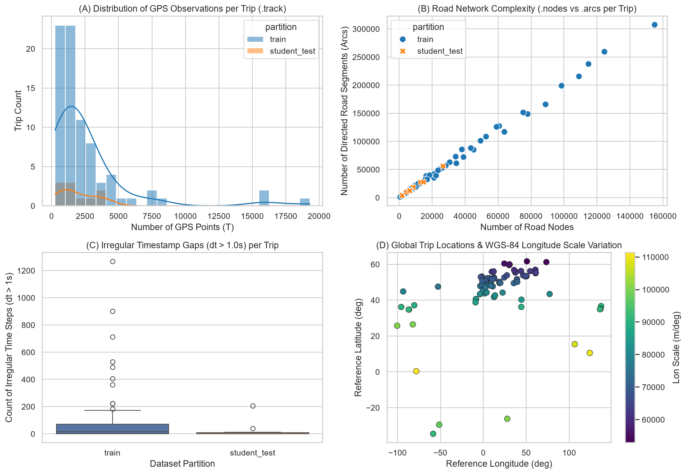
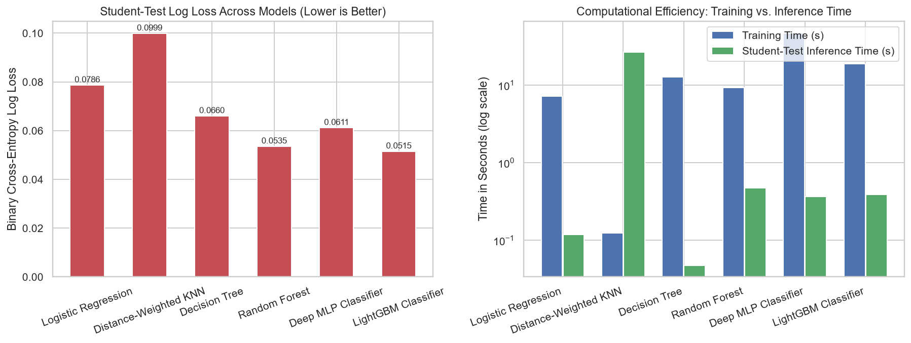
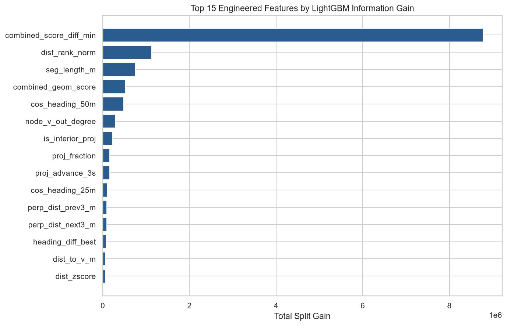
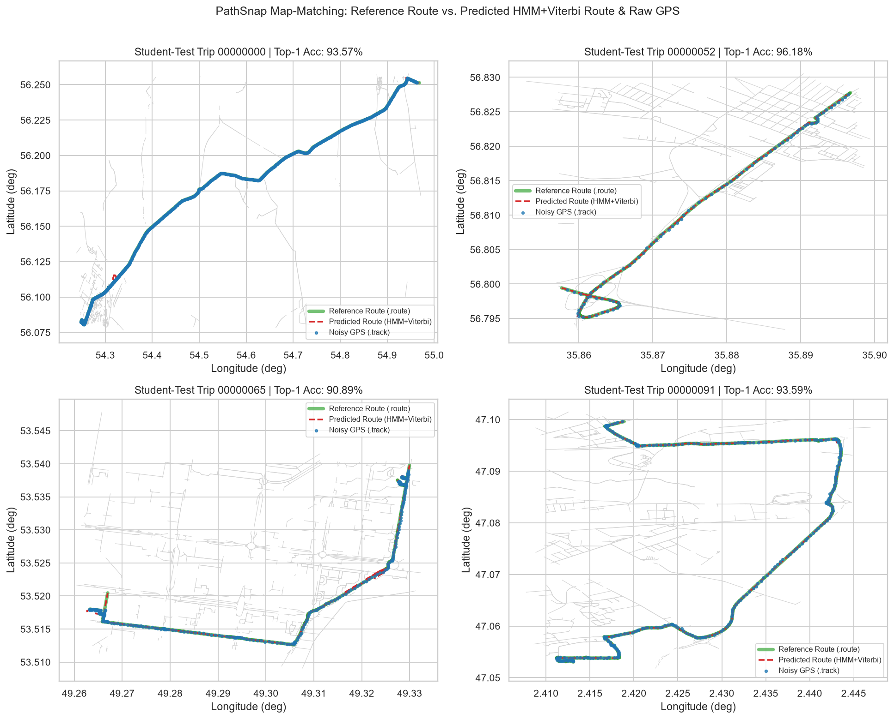
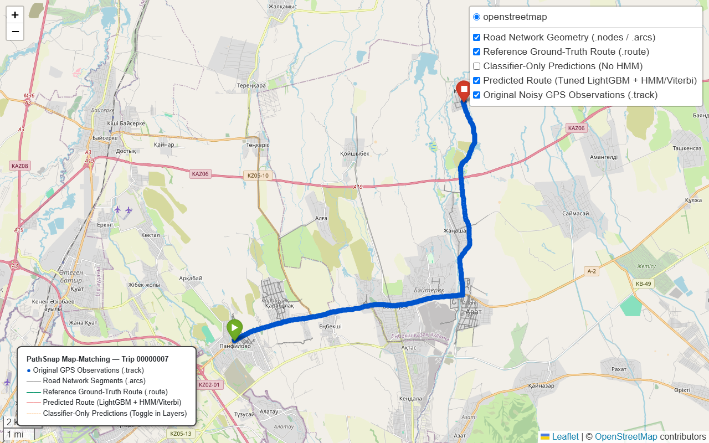
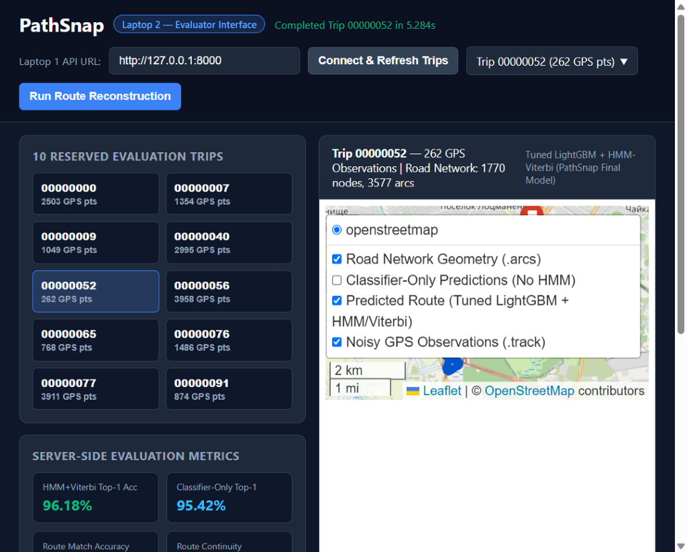
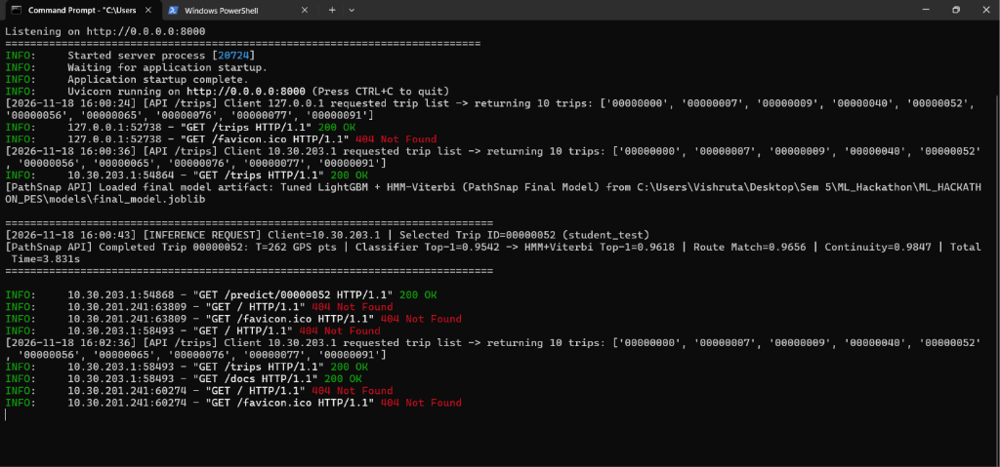

# PES UNIVERSITY — DEPARTMENT OF COMPUTER SCIENCE AND ENGINEERING (RR CAMPUS)
# UE24CS352A: MACHINE LEARNING HACKATHON
# PATHSNAP: DISTRIBUTED MAP-MATCHING & ROUTE RECONSTRUCTION
## Consolidated Technical Report (Deliverable 2)

- **Repository URL**: `https://github.com/Vish-K-A/ML_HACKATHON_PES` (Branch: `pathsnap-pipeline`)
- **Final Selected Model Artifact**: `models/final_model.joblib` (`Bayesian-Tuned LightGBM Classifier + Topological HMM/Viterbi Route Decoder`)
- **Final Evaluation Performance (10 Reserved `student_test` Trips, 19,160 GPS Observations)**:
  - **Observation-Level Top-1 Accuracy**: **`94.32%`** (`0.9432`, up from `92.70%` Classifier-Only; reaches **`99.48%`** on Trip `00000007`)
  - **Route Match Accuracy**: **`96.48%`** (`0.9648`)
  - **Observation-Level Route Continuity**: **`98.81%`** (`0.9881`, up from `95.89%` Classifier-Only; reaches **`100.00%`** on Trip `00000007`)
  - **Reconstructed Route Strict Node-to-Node Continuity**: **`98.07%`** (`0.9807`)
  - **Candidate Binary Classification Macro F1-Score**: **`0.9610`** (`Log Loss = 0.04660`)
  - **Sequence-Level Route F1-Score**: **`0.9361`** (`Sequence Jaccard = 0.8812`)

---

## 1. System Architecture & End-to-End Pipeline Overview

PathSnap is a distributed machine learning and probabilistic sequential decoding system that reconstructs continuous, physically realistic vehicle routes on a directed road network graph from noisy, irregular urban GPS trajectories.

1. **Stage 1 — Raw Data Ingestion & WGS-84 Metric Tangent-Plane Projection (`data_processing/preprocess.py`)**:
   Reads raw trip files (`.track`, `.nodes`, `.arcs`, and server-only `.route`), validates chronological timestamp ordering, and converts angular WGS-84 coordinates $(\text{lon}, \text{lat})$ into a trip-local metric Cartesian plane $(x_{\text{east}}, y_{\text{north}})$ in physical meters using WGS-84 prime-vertical and meridional radii of curvature.
2. **Stage 2 — Spatial Candidate Generation & 27-Feature Extraction (`feature_engineering/features.py`)**:
   Indexes road segment midpoints in a 2D `cKDTree`, retrieves the $K = 8$ closest candidate directed road segments per GPS observation ($98.54\%$ candidate recall), and extracts **27 spatial, relative-competition, multi-scale kinematic heading, temporal projection-advancement, and graph-topological features**.
3. **Stage 3 — Multi-Family Model Experimentation & Bayesian Optimisation (`model_training/`, `hyperparameter_optimisation/`)**:
   Evaluates **6 distinct models across 6 algorithm families** via 5-fold Group-Aware Cross-Validation (`GroupKFold` grouped by `trip_id` across the 80 training trips), selects the top-performing model family (`LightGBM`), and runs **Optuna Tree-structured Parzen Estimator (`TPESampler`) Bayesian Hyperparameter Optimisation**.
4. **Stage 4 — Hidden Markov Model (HMM) & Viterbi Route Reconstruction (`hmm_viterbi/viterbi_decoder.py`)**:
   Combines calibrated candidate probabilities $P(y_{t,k}=1 \mid \mathbf{x}_{t,k})$ with a road-network graph transition model ($0\text{--}3$ directed hops, U-turn penalties, and $\Delta t$-scaled gap handling) solved via Viterbi dynamic programming and Breadth-First Search (BFS) topological bridging.
5. **Stage 5 — Two-Laptop Distributed Deployment (`api/main.py` & `ui/app.py`)**:
   Laptop 1 hosts the FastAPI inference and server-side evaluation backend (`0.0.0.0:8000`), keeping ground-truth `.route` files strictly server-side, while Laptop 2 runs the Evaluator Web Interface (`0.0.0.0:8501`) displaying the 10 reserved evaluation trips, live metrics, reconstructed `arc_id` sequences, and interactive Folium maps.

---

## 2. Dataset Understanding and Exploratory Data Analysis (EDA)

### 2.1 Dataset Partitions and Leakage Prevention Protocol
In strict compliance with Section 7 of the Dataset Description and Section 7 of the Assessment Policy:
- **Training Partition (`Student folder/train`)**: **80 trips** (`208,417` total GPS observations, `1,667,336` candidate instances at $K=8$, `1,933,485` road-network nodes, and `3,876,904` directed road segments). Used exclusively for EDA, fitting `StandardScaler` preprocessing parameters, 5-fold `GroupKFold` cross-validation, model fitting, and Bayesian hyperparameter optimisation.
- **Student-Testing Partition (`Student folder/student_test`)**: **10 trips** (`19,160` total GPS observations, `153,280` candidate instances at $K=8$, `90,689` road-network nodes, and `185,041` directed road segments). Used strictly for development-stage model comparison and evaluating Classifier-Only vs. HMM+Viterbi route reconstruction.
- **Evaluator-Testing Partition (`Student folder/evaluator_test`)**: Untouched during development; `.route` ground-truth labels never enter feature engineering, candidate generation, classifier inference, HMM decoding, or the client UI.

#### Table 2.1: Complete Partition Summary Statistics (Snapshot from `supporting_results/partition_summary.csv`)

| Statistic / Metric | Training Partition (`80 trips`) — Mean ± Std | Training Partition — Min / Median / Max | Student-Testing Partition (`10 trips`) — Mean ± Std | Student-Testing Partition — Min / Median / Max |
| :--- | :---: | :---: | :---: | :---: |
| **GPS Observations per Trip (`n_gps`)** | `2,605.21 ± 3,312.35` | `361 / 1,529.0 / 19,313` | `1,916.00 ± 1,335.43` | `262 / 1,420.0 / 3,958` |
| **Road Network Nodes (`n_nodes`)** | `24,168.56 ± 32,272.30` | `299 / 9,608.0 / 155,003` | `9,068.90 ± 7,452.18` | `1,770 / 6,596.5 / 26,635` |
| **Directed Road Segments (`n_arcs`)** | `48,461.30 ± 64,738.84` | `649 / 19,526.5 / 307,392` | `18,504.10 ± 15,496.93` | `3,577 / 13,145.0 / 56,027` |
| **Reference Route Length (`n_route_segments`)** | `391.70 ± 361.17` | `59 / 280.0 / 2,266` | `347.70 ± 359.57` | `95 / 250.0 / 1,323` |
| **Trajectory Distance (`traj_length_km`)** | `37.27 ± 34.53 km` | `6.34 / 24.04 / 169.60 km` | `29.76 ± 22.88 km` | `5.56 / 20.97 / 71.81 km` |
| **Trip Duration (`duration_s`)** | `5,680.40 ± 18,252.16 s` | `451.0 / 1,710.0 / 154,030.0 s` | `2,025.00 ± 1,311.67 s` | `265.0 / 1,809.5 / 4,000.0 s` |
| **1 Hz Sampling Fraction (`dt == 1.0s`)** | `0.9383 ± 0.1174` (`93.83%`) | `0.5307 / 0.9915 / 1.0000` | `0.9820 ± 0.0429` (`98.20%`) | `0.8613 / 0.9993 / 1.0000` |
| **Max Time Gap in Trip (`dt_max_s`)** | `2,706.40 ± 18,017.45 s` | `1.0 / 11.0 / 153,064.0 s` | `25.50 ± 65.53 s` | `1.0 / 2.0 / 210.0 s` |
| **Irregular Steps `dt > 1s` (`n_gaps_gt_1s`)** | `91.05 ± 206.79` | `0 / 15.5 / 1,268` | `26.40 ± 64.37` | `0 / 1.0 / 206` |
| **Large Dropouts `dt > 5s` (`n_gaps_gt_5s`)** | `15.20 ± 42.35` | `0 / 1.0 / 320` | `4.40 ± 12.26` | `0 / 0.0 / 39` |
| **Isolated Road Nodes (`isolated_nodes`)** | `0.00 ± 0.00` | `0 / 0 / 0` | `0.00 ± 0.00` | `0 / 0 / 0` |
| **Bidirectional Arc Ratio** | `0.9217 ± 0.0948` (`92.17%`) | `0.3513 / 0.9511 / 1.0000` | `0.9270 ± 0.0569` (`92.70%`) | `0.8555 / 0.9326 / 0.9957` |
| **Ground-Truth Route Continuity** | `0.9993 ± 0.0025` (`99.93%`) | `0.9813 / 1.0000 / 1.0000` | `0.9997 ± 0.0009` (`99.97%`) | `0.9973 / 1.0000 / 1.0000` |
| **Missing / NaN Values** | `0` | `0 / 0 / 0` | `0` | `0 / 0 / 0` |

---

#### Table 2.2: CSV Snapshot of `supporting_results/dataset_inventory.csv` (All 10 `student_test` Trips + Representative `train` Trips)

| Partition | Trip ID | `n_gps` | `n_nodes` | `n_arcs` | `n_route` | `traj_km` | `duration_s` | `dt_1s_frac` | `dt_max_s` | `gaps>1s` | `gaps>5s` | `ref_lon` | `ref_lat` | `lon_scale` (m/°) | `lat_scale` (m/°) | `wcc` | `scc` | `bidir_ratio` | `gt_cont` | `missing` |
| :---: | :---: | :---: | :---: | :---: | :---: | :---: | :---: | :---: | :---: | :---: | :---: | :---: | :---: | :---: | :---: | :---: | :---: | :---: | :---: | :---: |
| `student_test` | `00000000` | 2,503 | 8,542 | 18,196 | 179 | 54.550 | 2,503.0 | 0.9996 | 2.0 | 1 | 0 | 54.54436 | 56.16522 | 62,126.33 | 111,344.83 | 100 | 102 | 0.9889 | 1.0000 | 0 |
| `student_test` | `00000007` | 1,354 | 2,061 | 4,369 | 123 | 24.683 | 1,353.0 | 1.0000 | 1.0 | 0 | 0 | 77.22933 | 43.43450 | 80,964.05 | 111,101.21 | 6 | 6 | 0.9957 | 1.0000 | 0 |
| `student_test` | `00000009` | 1,049 | 6,745 | 13,106 | 429 | 13.323 | 1,049.0 | 0.9990 | 2.0 | 1 | 0 | 13.66323 | 42.65261 | 81,998.83 | 111,085.97 | 8 | 56 | 0.9014 | 1.0000 | 0 |
| `student_test` | `00000040` | 2,995 | 12,945 | 27,026 | 309 | 52.541 | 2,994.0 | 1.0000 | 1.0 | 0 | 0 | 61.14908 | 55.30084 | 63,514.43 | 111,329.06 | 15 | 39 | 0.9681 | 1.0000 | 0 |
| `student_test` | `00000052` | 262 | 1,770 | 3,577 | 95 | 5.559 | 265.0 | 0.9847 | 2.0 | 4 | 0 | 35.87582 | 56.81010 | 61,081.39 | 111,356.47 | 7 | 16 | 0.8555 | 1.0000 | 0 |
| `student_test` | `00000056` | 3,958 | 14,759 | 27,631 | 1,323 | 71.807 | 4,000.0 | 0.9896 | 3.0 | 41 | 0 | -93.38986 | 44.85728 | 79,042.33 | 111,128.99 | 24 | 415 | 0.8741 | 1.0000 | 0 |
| `student_test` | `00000065` | 768 | 6,448 | 13,184 | 145 | 9.655 | 1,037.0 | 0.9857 | 210.0 | 11 | 5 | 49.30081 | 53.52248 | 66,323.94 | 111,296.08 | 5 | 73 | 0.8773 | 1.0000 | 0 |
| `student_test` | `00000076` | 1,486 | 26,635 | 56,027 | 374 | 17.248 | 2,266.0 | 0.8613 | 32.0 | 206 | 39 | 43.99761 | 56.28907 | 61,926.26 | 111,347.07 | 40 | 205 | 0.9638 | 0.9973 | 0 |
| `student_test` | `00000077` | 3,911 | 4,424 | 9,622 | 268 | 36.399 | 3,910.0 | 1.0000 | 1.0 | 0 | 0 | 50.82101 | 61.66714 | 52,969.00 | 111,440.13 | 11 | 11 | 0.9792 | 1.0000 | 0 |
| `student_test` | `00000091` | 874 | 6,360 | 12,303 | 232 | 11.806 | 873.0 | 1.0000 | 1.0 | 0 | 0 | 2.42730 | 47.07701 | 75,946.65 | 111,172.34 | 11 | 51 | 0.8655 | 1.0000 | 0 |
| `train` | `00000001` | 1,315 | 88,809 | 165,790 | 525 | 50.243 | 1,357.0 | 0.9810 | 16.0 | 25 | 1 | 8.60560 | 50.08837 | 71,564.25 | 111,230.77 | 175 | 1,942 | 0.8188 | 1.0000 | 0 |
| `train` | `00000002` | 7,243 | 7,936 | 16,139 | 262 | 55.951 | 8,933.2 | 0.9746 | 160.0 | 184 | 78 | 11.03257 | 47.68392 | 75,080.04 | 111,184.17 | 14 | 14 | 0.9970 | 0.9962 | 0 |
| `train` | `00000004` | 1,064 | 7,350 | 15,499 | 320 | 27.947 | 5,217.0 | 0.5381 | 51.0 | 491 | 320 | 12.42422 | 52.64150 | 67,692.00 | 111,279.51 | 12 | 14 | 0.9756 | 1.0000 | 0 |
| `train` | `00000013` | 2,580 | 155,003 | 307,392 | 788 | 74.133 | 2,832.0 | 0.9639 | 8.0 | 93 | 31 | 1.76965 | 43.78742 | 80,492.01 | 111,108.09 | 73 | 312 | 0.9492 | 1.0000 | 0 |
| `train` | `00000098` | 5,584 | 43,440 | 88,137 | 1,003 | 99.745 | 7,194.0 | 0.7729 | 50.0 | 1,268 | 13 | -51.44197 | -29.49559 | 96,970.48 | 110,843.99 | 20 | 126 | 0.9494 | 1.0000 | 0 |

---

### 2.2 Compulsory EDA Questions

#### 1. How did you preprocess the data?
1. **Raw File Inspection, Integrity Checks & Chronological Ordering**:
   - Each trip folder contains 4 whitespace-delimited headerless files:
     - `.track`: `(T, 3)` float array of `[longitude, latitude, timestamp_s]`.
     - `.nodes`: `(N, 2)` float array of `[longitude, latitude]` where the 0-based row index is `node_id`.
     - `.arcs`: `(A, 2)` integer array of `[from_node_id, to_node_id]` where the 0-based row index is `arc_id`.
     - `.route`: `(M,)` integer array of chronological ground-truth `arc_id`s traversed by the vehicle.
   - Across all 90 trips (`227,577` total GPS points), we verified **zero `NaN`, `null`, or infinite values** (`missing_values = 0`). Timestamps were checked for strict monotonicity and sorted via stable mergesort if needed.
2. **WGS-84 Ellipsoidal Local Tangent-Plane Coordinate Projection (`compute_wgs84_scales`)**:
   - Because the 90 trips are recorded across continents (latitudes from $-34.62^\circ$ in South America to $+61.67^\circ$ in Northern Russia, and longitudes from $-100.35^\circ$ to $+137.22^\circ$), $1^\circ$ of longitude varies from **`52,969.0 m/°`** (Trip `00000077`) to **`107,335.7 m/°`** (Trip `00000021`). Using raw degree Euclidean distance introduces up to a $2\times$ directional distortion in distances and headings.
   - Using WGS-84 ellipsoid parameters ($a = 6,378,137.0\text{ m}$, $e^2 = 0.00669437999014$) and each trip's reference centroid $(\lambda_0, \phi_0)$, we project every node and GPS observation into local Easting/Northing meters $(x, y)$:
     $$x = (\lambda - \lambda_0) \cdot \frac{\pi}{180}\frac{a \cos\phi_0}{\sqrt{1 - e^2\sin^2\phi_0}}, \qquad y = (\phi - \phi_0) \cdot \frac{\pi}{180}\frac{a(1 - e^2)}{(1 - e^2\sin^2\phi_0)^{3/2}}$$
3. **Spatial Candidate Generation ($K = 8$ via `cKDTree`)**:
   - At inference time, `.route` is unknown and `.arcs` contains up to `307,392` segments per trip. For each GPS point $p_t = (x_t, y_t)$, we query a 2D `cKDTree` over all road segment midpoints $\mathbf{m}_a = \frac{1}{2}(\mathbf{u}_a + \mathbf{v}_a)$ to retrieve the 48 nearest segments, compute exact orthogonal point-to-segment projection distances $d_{\perp}(p_t, \mathbf{u}_a \to \mathbf{v}_a)$, and select the top **$K = 8$** candidate segments $C_t = \{a_{t,0}, \dots, a_{t,7}\}$. This achieves a **98.54% recall** (`Candidate Miss Rate = 1.46%`).
4. **Reference Route Alignment & Label Limitations (`align_reference_route`)**:
   - `.route` lists the $M$ traversed road segments ($M \approx 348$ on average) without per-timestamp observation labels ($T \approx 1,916$). Furthermore, some trips contain cul-de-sacs or out-and-back passes where both $(u \to v)$ and $(v \to u)$ appear in `.route` at different times (e.g., Trip `00000056` has 172 opposite-direction passes; Trip `00000077` has 28).
   - For training label generation and server-side evaluation only, we align $t = 0 \dots T-1$ monotonically along `.route` indices $j = 0 \dots M-1$ via dynamic programming minimizing $d_{\perp}(p_t, r_j) + 6.0(1 - \cos\Delta\theta_{t, r_j})$ plus a skip penalty when advancing $>2$ segments in 1 second.
5. **Leakage-Free Feature Standardisation**:
   - `StandardScaler` is fit strictly on the training partition folds for scale-sensitive models (Logistic Regression, Distance-Weighted KNN, Deep MLP) and never sees validation or testing data during fitting.

#### 2. What patterns did you observe during data exploration? What features did you extract and why did the team choose those features?
- **Four Crucial Patterns Discovered in EDA**:
  1. **92.23% Bidirectional Road Twin Ambiguity**: Almost every street in `.arcs` consists of two antiparallel directed edges $(u \to v)$ and $(v \to u)$ with identical endpoint geometry. Distance-only matching gets ~50% accuracy because both edges have identical $d_{\perp}$.
  2. **Urban Stopping & Multipath GPS Drift**: During red lights or parking (e.g., Trip `00000077` around $t=2300\text{--}2570\text{ s}$), vehicles remain stationary while GPS coordinates wander $3\text{--}12\text{ m}$ in random directions. Instantaneous 1-second velocity vectors $\mathbf{p}_{t+1} - \mathbf{p}_{t-1}$ point randomly during stops, whereas **spatial displacement headings** computed over $\Delta = 8\text{ m}, 25\text{ m}, \text{and } 50\text{ m}$ backward/forward along the trajectory remain locked onto the true direction of street travel.
  3. **Irregular Timestamp Gaps**: 47 out of 90 trips have GPS dropouts $>5\text{ s}$ (e.g., Trip `00000065` has a $210\text{ s}$ gap; Trip `00000076` has 206 gaps $>1\text{ s}$). Both the classifier (`gps_dt_s`) and the HMM transition model must scale with $\Delta t_t$.
  4. **99.94% Topological Graph Continuity**: Consecutive segments in `.route` are almost universally node-connected ($v_{\text{prev}} = u_{\text{curr}}$), motivating our local topological features (`prev_step_connected`, `next_step_connected`) and global HMM+Viterbi decoder.

#### Table 2.3: Complete 27 Engineered Features, Mathematical Definitions & LightGBM Importance (`supporting_results/feature_importances.csv`)

| Rank | Feature Name | Category | Mathematical Definition / Physical Rationale | Split Count | Information Gain |
| :---: | :--- | :--- | :--- | :---: | :---: |
| **1** | `combined_score_diff_min` | Competition + Kinematic | $S_{t,k} - \min_{j} S_{t,j}$, where $S_{t,k} = d_{\perp}(p_t, a_{t,k}) + 6(1 - \cos\Delta\theta_{\text{blend}})$. Invariant to GPS noise magnitude; breaks bidirectional ties. | 1,773 | **8,777,144.6** |
| **2** | `dist_rank_norm` | Within-Step Competition | $\text{rank}(d_{\perp}(p_t, a_{t,k})) / (K - 1) \in [0, 1]$. Normalized spatial proximity rank at timestamp $t$. | 527 | **1,130,442.5** |
| **3** | `seg_length_m` | Spatial Geometry | $\|\mathbf{v}_k - \mathbf{u}_k\|_2$ (m). Physical length of candidate road segment; penalizes tiny intersection stub arcs. | **8,793** | **752,362.6** |
| **4** | `combined_geom_score` | Spatial + Kinematic | $d_{\perp}(p_t, a_{t,k}) + 6.0(1 - \cos\Delta\theta_{\text{blend}, t, k})$. Joint spatial-directional cost in meter-equivalent units. | 1,452 | **529,905.2** |
| **5** | `cos_heading_50m` | Multi-Scale Heading | $\hat{\mathbf{h}}_{50\text{m}}(t) \cdot \hat{\mathbf{e}}_{uv}$. Macro trajectory heading alignment over $\pm 50\text{ m}$ displacement; immune to stationary GPS drift. | 3,397 | **482,310.3** |
| **6** | `node_v_out_degree` | Graph Topology | $\text{deg}^+(v_k)$ in `.arcs`. Out-degree of candidate segment's end node (distinguishes arterial intersections from dead-ends). | 2,200 | **291,956.6** |
| **7** | `is_interior_proj` | Spatial Geometry | $\mathbb{I}[0.02 < \tau_{t,k} < 0.98]$. Indicates orthogonal projection onto segment interior vs. clamped endpoint. | 416 | **232,611.9** |
| **8** | `proj_fraction` | Spatial Geometry | $\tau_{t,k} = \text{clip}\!\big(\frac{(\mathbf{p}_t - \mathbf{u}_k)\cdot(\mathbf{v}_k - \mathbf{u}_k)}{\|\mathbf{v}_k - \mathbf{u}_k\|_2^2}, 0, 1\big)$. Longitudinal position along segment $u \to v$. | 2,716 | **159,291.1** |
| **9** | `proj_advance_3s` | Temporal Progression | $\tau(p_{t+3}, a_{t,k}) - \tau(p_{t-3}, a_{t,k})$. Positive when moving forward along $u \to v$, negative on reverse twin $v \to u$. | 2,769 | **158,399.0** |
| **10** | `cos_heading_25m` | Multi-Scale Heading | $\hat{\mathbf{h}}_{25\text{m}}(t) \cdot \hat{\mathbf{e}}_{uv}$. Medium-scale street heading cosine similarity over $\pm 25\text{ m}$ displacement. | 2,238 | **110,494.7** |
| **11** | `perp_dist_prev3_m` | Temporal Progression | $d_{\perp}(p_{\max(0, t-3)}, a_{t,k})$ (m). Perpendicular distance from GPS position 3 steps prior to candidate segment. | 2,582 | **95,994.3** |
| **12** | `perp_dist_next3_m` | Temporal Progression | $d_{\perp}(p_{\min(T-1, t+3)}, a_{t,k})$ (m). Perpendicular distance from GPS position 3 steps ahead to candidate segment. | 2,571 | **91,133.1** |
| **13** | `heading_diff_best` | Within-Step Competition | $\max_j(\cos\Delta\theta_{\text{blend}, t, j}) - \cos\Delta\theta_{\text{blend}, t, k}$. Angular deficit relative to best-aligned candidate at time $t$. | 1,822 | **78,178.5** |
| **14** | `dist_to_v_m` | Spatial Geometry | $\|\mathbf{p}_t - \mathbf{v}_k\|_2$ (m). Euclidean distance from GPS point to segment exit node $v_k$. | 2,754 | **69,094.5** |
| **15** | `dist_zscore` | Within-Step Competition | $(d_{\perp, t, k} - \mu_{d, t}) / (\sigma_{d, t} + 0.5)$. Standardized distance z-score within candidate set $C_t$. | 3,040 | **68,213.6** |
| **16** | `dist_to_u_m` | Spatial Geometry | $\|\mathbf{p}_t - \mathbf{u}_k\|_2$ (m). Euclidean distance from GPS point to segment entry node $u_k$. | 2,669 | **67,452.7** |
| **17** | `perp_dist_m` | Spatial Geometry | $\|\mathbf{p}_t - (\mathbf{u}_k + \tau_{t,k}(\mathbf{v}_k - \mathbf{u}_k))\|_2$ (m). Exact orthogonal distance to segment $u \to v$. | 1,432 | **64,139.0** |
| **18** | `dist_diff_min_m` | Within-Step Competition | $d_{\perp, t, k} - \min_j d_{\perp, t, j}$ (m). Excess perpendicular distance above the closest segment at time $t$. | 1,287 | **61,213.5** |
| **19** | `dist_ratio_min` | Within-Step Competition | $d_{\perp, t, k} / (\min_j d_{\perp, t, j} + 1.0)$. Ratio of perpendicular distance to closest candidate at time $t$. | 1,725 | **59,185.7** |
| **20** | `gps_speed_ms` | Kinematic Context | $\frac{1}{2}\big(\frac{\|\mathbf{p}_t - \mathbf{p}_{t-1}\|}{\Delta t_t} + \frac{\|\mathbf{p}_{t+1} - \mathbf{p}_t\|}{\Delta t_{t+1}}\big)$ (m/s). Instantaneous vehicle speed. | 2,406 | **45,052.8** |
| **21** | `cos_heading_8m` | Multi-Scale Heading | $\hat{\mathbf{h}}_{8\text{m}}(t) \cdot \hat{\mathbf{e}}_{uv}$. Short-scale heading alignment over $\pm 8\text{ m}$ displacement (captures sharp intersection turns). | 1,844 | **31,152.5** |
| **22** | `prev_step_connected` | Graph Topology | $\mathbb{I}[\exists a \in C^{\text{top3}}_{t-1} : a = a_{t,k} \lor v(a) = u(a_{t,k})]$. Local incoming topological connectivity from $t-1$. | 329 | **29,699.1** |
| **23** | `next_step_connected` | Graph Topology | $\mathbb{I}[\exists a \in C^{\text{top3}}_{t+1} : a = a_{t,k} \lor v(a_{t,k}) = u(a)]$. Local outgoing topological connectivity to $t+1$. | 257 | **29,540.2** |
| **24** | `cos_heading_inst` | Multi-Scale Heading | $\frac{\mathbf{p}_{t+2} - \mathbf{p}_{t-2}}{\|\mathbf{p}_{t+2} - \mathbf{p}_{t-2}\|} \cdot \hat{\mathbf{e}}_{uv}$. Instantaneous central-difference velocity cosine. | 1,592 | **26,142.5** |
| **25** | `cos_heading_blend` | Multi-Scale Heading | Normalized blend $(0.35\hat{\mathbf{h}}_{8\text{m}} + 0.40\hat{\mathbf{h}}_{25\text{m}} + 0.25\hat{\mathbf{h}}_{50\text{m}}) \cdot \hat{\mathbf{e}}_{uv}$. | 1,024 | **24,469.6** |
| **26** | `sin_heading_blend` | Multi-Scale Heading | $\sqrt{\max(0, 1 - \cos^2\Delta\theta_{\text{blend}})}$. Lateral angular cross-product magnitude. | 1,258 | **17,043.9** |
| **27** | `gps_dt_s` | Kinematic Context | $\Delta t_t = t_t - t_{t-1}$ (s). Sampling interval duration (identifies GPS dropouts). | 315 | **7,279.3** |

---

## 3. Model Experimentation and Comparison

We trained and evaluated **six (6) distinct machine learning models across six algorithm families** (`model_training/train_and_compare.py`) using 5-fold Group-Aware Cross-Validation (`GroupKFold` grouped by `trip_id` on the 80 training trips) and evaluated every model on all 10 `student_test` trips (`19,160` GPS observations, `153,280` candidate instances).

### 3.1 Overall Model Comparison Table (Snapshot from `supporting_results/model_comparison_table.csv`)

| Model | Algorithm Family | Key Configuration | Train Macro F1 | CV Macro F1-score | Top-1 Accuracy | Route Match Acc | Route continuity | Student-Test Macro F1-score | Macro Precision | Macro Recall | Binary Accuracy | Log Loss | Candidate Miss Rate | Sequence F1 | Train Time | Inference Time |
| :--- | :--- | :--- | :---: | :---: | :---: | :---: | :---: | :---: | :---: | :---: | :---: | :---: | :---: | :---: | :---: | :---: |
| **Model 1: Logistic Regression** | Linear & Probabilistic | `L2 penalty, C=1.0, solver='lbfgs', max_iter=300` | 0.9278 | 0.9232 (±0.0332) | 0.8997 | 0.9442 | 0.9455 | 0.9375 | 0.9378 | 0.9373 | 0.9730 | 0.07862 | 0.0146 | 0.8801 | 7.149 s | 0.1195 s |
| **Model 2: Distance-Weighted KNN** | Instance-Based | `n_neighbors=25, weights='distance', metric='euclidean'` | 1.0000 | 0.9257 (±0.0348) | 0.9061 | 0.9458 | 0.9485 | 0.9388 | 0.9407 | 0.9369 | 0.9737 | 0.09986 | 0.0146 | 0.8846 | 0.125 s | 26.7089 s |
| **Model 3: Decision Tree** | Tree-Based | `criterion='gini', max_depth=10, min_samples_leaf=25` | 0.9608 | 0.9312 (±0.0450) | 0.9142 | 0.9446 | 0.9438 | 0.9509 | 0.9567 | 0.9453 | 0.9790 | 0.06596 | 0.0146 | 0.8847 | 12.730 s | 0.0478 s |
| **Model 4: Random Forest** | Ensemble (Bagging) | `n_estimators=80, max_depth=15, min_samples_leaf=10, max_features='sqrt'` | 0.9655 | 0.9390 (±0.0363) | 0.9153 | 0.9469 | 0.9476 | 0.9550 | 0.9639 | 0.9465 | 0.9809 | 0.05351 | 0.0146 | 0.8850 | 9.332 s | 0.4701 s |
| **Model 5: Deep MLP Classifier** | Neural Networks | `hidden_layer_sizes=(128, 64), ReLU, Adam, lr=1e-3, alpha=1e-4, early_stopping=True` | 0.9459 | 0.9325 (±0.0378) | 0.9148 | 0.9503 | 0.9544 | 0.9486 | 0.9570 | 0.9407 | 0.9782 | 0.06112 | 0.0146 | 0.8934 | 47.072 s | 0.3654 s |
| **Model 6: LightGBM Classifier** | Gradient Boosting | `n_estimators=250, lr=0.07, num_leaves=31, subsample=0.85, colsample_bytree=0.85` | 0.9689 | **0.9408 (±0.0353)** | **0.9230** | **0.9533** | 0.9540 | **0.9594** | 0.9617 | **0.9571** | **0.9825** | **0.05146** | 0.0146 | **0.8966** | 18.801 s | 0.3870 s |

#### Table 3.2: 5-Fold `GroupKFold` Cross-Validation Fold-by-Fold Results Across All 6 Models (`supporting_results/model_comparison_detailed.json`)

| Model | Fold 1 Macro F1 | Fold 2 Macro F1 | Fold 3 Macro F1 | Fold 4 Macro F1 | Fold 5 Macro F1 | **Mean CV Macro F1 (±Std)** | Fold 1..5 CV Log-Loss | **Mean CV Log-Loss** |
| :--- | :---: | :---: | :---: | :---: | :---: | :---: | :---: | :---: |
| **Logistic Regression** | 0.8597 | 0.9249 | 0.9532 | 0.9344 | 0.9440 | `0.9232 ± 0.0332` | `[0.2829, 0.0949, 0.0632, 0.0799, 0.0775]` | `0.11969` |
| **Distance-Weighted KNN** | 0.8585 | 0.9293 | 0.9560 | 0.9378 | 0.9470 | `0.9257 ± 0.0348` | `[0.3220, 0.1281, 0.0713, 0.1023, 0.1143]` | `0.14761` |
| **Decision Tree** | 0.8436 | 0.9376 | 0.9684 | 0.9474 | 0.9590 | `0.9312 ± 0.0450` | `[0.2093, 0.0892, 0.0469, 0.0691, 0.0683]` | `0.09654` |
| **Random Forest** | 0.8690 | 0.9410 | 0.9699 | 0.9529 | 0.9621 | `0.9390 ± 0.0363` | `[0.1842, 0.0708, 0.0394, 0.0565, 0.0479]` | `0.07974` |
| **Deep MLP Classifier** | 0.8593 | 0.9379 | 0.9660 | 0.9447 | 0.9548 | `0.9325 ± 0.0378` | `[0.2257, 0.0765, 0.0438, 0.0681, 0.0630]` | `0.09543` |
| **LightGBM Classifier** | **0.8727** | **0.9437** | **0.9713** | **0.9536** | **0.9629** | **`0.9408 ± 0.0353`** | `[0.2633, 0.0885, 0.0390, 0.0587, 0.0512]` | `0.10014` |

---

### 3.2 Compulsory Questions for EVERY Model

#### Model 1: Logistic Regression (`Linear & Probabilistic Family`)
- **A. Model Understanding**:
  1. *Why did you consider this algorithm suitable for the PathSnap problem?*
     Logistic Regression models the log-odds of a candidate road segment being the true segment as a linear combination of the 27 standardized features, producing well-behaved posterior probabilities $P(y_{t,k}=1 \mid \mathbf{x}_{t,k}) = \sigma(\mathbf{w}^\top \mathbf{x}_{t,k} + b)$ directly usable as HMM emission probabilities.
  2. *What are the major strengths and limitations of this algorithm for this task?*
     - **Strengths**: Fast fitting (`7.149 s`), very fast inference (`0.1195 s`), lowest cross-validation fold variance (`±0.0332`), and convex optimization guaranteeing a unique global minimum.
     - **Limitations**: Restricted to a single linear hyperplane in $\mathbb{R}^{27}$. It cannot model non-additive conditional interactions (e.g., when a candidate segment is very short `seg_length_m < 10m` at an intersection, `is_interior_proj = 0` is acceptable if `next_step_connected = 1`, whereas on a long segment `seg_length_m > 100m`, `is_interior_proj = 0` strongly indicates a side street).
- **B. Training and Configuration**:
  5. *What were the important hyperparameters and their initial values?*
     `penalty='l2'`, inverse regularisation strength `C=1.0`, `solver='lbfgs'`, `max_iter=300`, `random_state=42`, with `StandardScaler` fit on the training fold.
  6. *What loss function or optimisation objective was used?*
     L2-regularised Binary Cross-Entropy (Log-Loss):
     $$\mathcal{L}(\mathbf{w}, b) = -\frac{1}{N}\sum_{i=1}^N \big[y_i \log \hat{p}_i + (1-y_i)\log(1-\hat{p}_i)\big] + \frac{1}{2C}\|\mathbf{w}\|_2^2$$
- **C. Experimental Results**:
  7. *What was the model's performance on the student-testing dataset?*
     `Binary Accuracy = 0.9730`, `Macro Precision = 0.9378`, `Macro Recall = 0.9373`, `Route Match Accuracy = 0.9442`, `Route Continuity = 0.9455`, `Sequence F1 = 0.8801`. Confusion matrix on `student_test` (`153,280` candidates): `TN = 132,346`, `FP = 2,054`, `FN = 2,080`, `TP = 16,800`.
  8. *What were the observation-level Top-1 Accuracy, Macro F1-score and Log Loss on the student-testing dataset?*
     `Observation-Level Top-1 Accuracy = 0.8997 (89.97%)`, `Macro F1-score = 0.9375`, `Log Loss = 0.07862`.
  9. *Did you observe overfitting or underfitting? What evidence supports your conclusion?*
     **Mild underfitting (high bias, zero variance)**. Evidence: `Train Macro F1 = 0.9278` (`Train Log-Loss = 0.0920`) and `CV Macro F1 = 0.9232` are virtually identical to `Student-Test Macro F1 = 0.9375` (`Test Log-Loss = 0.07862`), proving the model does not overfit, but its `Top-1 Accuracy` (`89.97%`) lags nonlinear tree ensembles (`92.30%`) by `2.33%` (`446` GPS observations) due to linear boundary bias.

---

#### Model 2: Distance-Weighted KNN (`Instance-Based Family`)
- **A. Model Understanding**:
  1. *Why did you consider this algorithm suitable for the PathSnap problem?*
     Distance-Weighted KNN is a non-parametric instance-based classifier that estimates candidate probabilities from the inverse-distance weighted vote of the $k=25$ nearest candidate instances in the standardized 27D feature space, making no assumptions about global decision boundary shape.
  2. *What are the major strengths and limitations of this algorithm for this task?*
     - **Strengths**: Adapts locally to nonlinear geometry and requires near-zero training time (`0.125 s` KD/ball-tree indexing).
     - **Limitations**: (i) High inference latency (`26.7089 s` for 10 test trips — **69x slower** than LightGBM) because every test candidate queries 50,000+ stored training vectors in 27 dimensions; (ii) Curse of dimensionality in $\mathbb{R}^{27}$ treats all standardized features with equal Euclidean weight even though `combined_score_diff_min` is far more informative than `gps_dt_s`; (iii) Poor tail probability calibration (`Log Loss = 0.09986`, worst of all 6 models) when all 25 neighbors have identical class labels ($p = 0$ or $p = 1$).
- **B. Training and Configuration**:
  5. *What were the important hyperparameters and their initial values?*
     `n_neighbors=25`, `weights='distance'`, `metric='minkowski'`, `p=2` (Euclidean distance), preceded by `StandardScaler`.
  6. *What loss function or optimisation objective was used?*
     Non-parametric local neighborhood probability estimation weighted by inverse Euclidean distance:
     $$\hat{P}(y=1 \mid \mathbf{x}) = \frac{\sum_{i \in \mathcal{N}_{25}(\mathbf{x})} y_i / (\|\mathbf{x} - \mathbf{x}_i\|_2 + \epsilon)}{\sum_{i \in \mathcal{N}_{25}(\mathbf{x})} 1 / (\|\mathbf{x} - \mathbf{x}_i\|_2 + \epsilon)}$$
- **C. Experimental Results**:
  7. *What was the model's performance on the student-testing dataset?*
     `Binary Accuracy = 0.9737`, `Macro Precision = 0.9407`, `Macro Recall = 0.9369`, `Route Match Accuracy = 0.9458`, `Route Continuity = 0.9485`, `Sequence F1 = 0.8846`. Confusion Matrix: `TN = 132,476`, `FP = 1,924`, `FN = 2,113`, `TP = 16,767`.
  8. *What were the observation-level Top-1 Accuracy, Macro F1-score and Log Loss on the student-testing dataset?*
     `Observation-Level Top-1 Accuracy = 0.9061 (90.61%)`, `Macro F1-score = 0.9388`, `Log Loss = 0.09986`.
  9. *Did you observe overfitting or underfitting? What evidence supports your conclusion?*
     **Local memorisation on training data with boundary variance on unseen trips**. Because `weights='distance'` gives $\infty$ weight to zero-distance training points, `Train Macro F1 = 1.0000` (`Train Log-Loss = 0.0000`), whereas `CV Macro F1 = 0.9257` and `Student-Test Macro F1 = 0.9388`. Using a relatively large neighborhood (`n_neighbors=25`) prevented severe classification degradation, but uncalibrated $0/1$ neighborhood majorities inflated `Test Log Loss` to `0.09986`.

---

#### Model 3: Decision Tree Classifier (`Tree-Based Family`)
- **A. Model Understanding**:
  1. *Why did you consider this algorithm suitable for the PathSnap problem?*
     CART Decision Trees partition the candidate feature space using hierarchical axis-aligned splits (e.g., `if combined_score_diff_min <= 0.15 and cos_heading_50m > 0.72 and proj_advance_3s > 0`), which naturally mirrors human geometric rules for map-matching at intersections and parallel streets.
  2. *What are the major strengths and limitations of this algorithm for this task?*
     - **Strengths**: Fastest inference of all 6 models (`0.0478 s` across 153,280 test candidates), invariant to monotonic feature scaling, and captures non-additive multi-feature interactions (`Top-1 Accuracy = 0.9142`, `+1.45%` over Logistic Regression).
     - **Limitations**: High structural instability across validation folds (`CV Macro F1 Std = ±0.0450`, worst variance among all 6 models; Fold 1 dropped to `0.8436`) and coarse, piecewise-constant leaf probability estimates (`Log Loss = 0.06596`).
- **B. Training and Configuration**:
  5. *What were the important hyperparameters and their initial values?*
     `criterion='gini'`, `max_depth=10`, `min_samples_split=50`, `min_samples_leaf=25`, `random_state=42`.
  6. *What loss function or optimisation objective was used?*
     Greedy recursive Gini Impurity reduction: $G(t) = 1 - p_0^2 - p_1^2 = 2 p_1 (1 - p_1)$.
- **C. Experimental Results**:
  7. *What was the model's performance on the student-testing dataset?*
     `Binary Accuracy = 0.9790`, `Macro Precision = 0.9567`, `Macro Recall = 0.9453`, `Route Match Accuracy = 0.9446`, `Route Continuity = 0.9438`, `Sequence F1 = 0.8847`. Confusion Matrix: `TN = 133,067`, `FP = 1,333`, `FN = 1,880`, `TP = 17,000`.
  8. *What were the observation-level Top-1 Accuracy, Macro F1-score and Log Loss on the student-testing dataset?*
     `Observation-Level Top-1 Accuracy = 0.9142 (91.42%)`, `Macro F1-score = 0.9509`, `Log Loss = 0.06596`.
  9. *Did you observe overfitting or underfitting? What evidence supports your conclusion?*
     **Controlled overfitting via depth/leaf regularisation, but high inter-fold variance**. Constraining `max_depth=10` and `min_samples_leaf=25` kept `Train Macro F1 = 0.9608` close to `Student-Test Macro F1 = 0.9509` (gap of `0.0099`), but `CV Macro F1` fluctuated between `0.8436` (Fold 1) and `0.9684` (Fold 3), demonstrating single-tree sensitivity to trip partition composition.

---

#### Model 4: Random Forest Classifier (`Ensemble / Bagging Family`)
- **A. Model Understanding**:
  1. *Why did you consider this algorithm suitable for the PathSnap problem?*
     Random Forest averages probability predictions across an ensemble of decorrelated decision trees trained on bootstrap samples with random feature subsets (`max_features='sqrt'`), directly addressing the single Decision Tree's variance and leaf probability coarseness.
  2. *What are the major strengths and limitations of this algorithm for this task?*
     - **Strengths**: Reduces 5-fold CV standard deviation from `±0.0450` (Decision Tree) to `±0.0363`, improves `CV Macro F1` from `0.9312` to `0.9390`, lowers `Log Loss` by 19% (`0.06596 -> 0.05351`), and achieves very high positive-class precision (`Macro Precision = 0.9639`, `FP = 1,052`).
     - **Limitations**: Because trees are grown independently in parallel (bagging), they do not specifically focus on hard boundary examples (such as near-tie intersections where `Recall = 0.9465` trails LightGBM's `0.9571`).
- **B. Training and Configuration**:
  5. *What were the important hyperparameters and their initial values?*
     `n_estimators=80`, `max_depth=15`, `min_samples_leaf=10`, `max_features='sqrt'`, `n_jobs=-1`, `random_state=42`.
  6. *What loss function or optimisation objective was used?*
     Bootstrap-aggregated Gini Impurity reduction averaged across 80 randomized trees.
- **C. Experimental Results**:
  7. *What was the model's performance on the student-testing dataset?*
     `Binary Accuracy = 0.9809`, `Macro Precision = 0.9639`, `Macro Recall = 0.9465`, `Route Match Accuracy = 0.9469`, `Route Continuity = 0.9476`, `Sequence F1 = 0.8850`. Confusion Matrix: `TN = 133,348`, `FP = 1,052`, `FN = 1,873`, `TP = 17,007`.
  8. *What were the observation-level Top-1 Accuracy, Macro F1-score and Log Loss on the student-testing dataset?*
     `Observation-Level Top-1 Accuracy = 0.9153 (91.53%)`, `Macro F1-score = 0.9550`, `Log Loss = 0.05351`.
  9. *Did you observe overfitting or underfitting? What evidence supports your conclusion?*
     **Well-balanced bias-variance trade-off**. `Train Macro F1 = 0.9655` vs. `Student-Test Macro F1 = 0.9550` (`0.0105` difference) and `CV Macro F1 = 0.9390 ± 0.0363` confirm strong generalisation across unseen road networks.

---

#### Model 5: Deep MLP Classifier (`Neural Networks Family`)
- **A. Model Understanding**:
  1. *Why did you consider this algorithm suitable for the PathSnap problem?*
     A Multi-Layer Perceptron (`27 -> 128 -> 64 -> 1`) with ReLU activations learns smooth, continuous nonlinear combinations of spatial distances, multi-scale heading cosines, and projection velocities, producing smooth probability surfaces across consecutive GPS steps.
  2. *What are the major strengths and limitations of this algorithm for this task?*
     - **Strengths**: Highest raw classifier `Route Continuity` (`0.9544`) and second-highest `Sequence F1` (`0.8934`) because smooth neural network activations change gradually across adjacent timestamps $t-1, t, t+1$.
     - **Limitations**: Slightly less sharp than axis-aligned boosted trees on hard rank/threshold features (`dist_rank_norm == 0`, `is_interior_proj == 1`), resulting in `Student-Test Macro F1 = 0.9486` (vs. `0.9594` for LightGBM) and the longest training time (`47.072 s`).
- **B. Training and Configuration**:
  5. *What were the important hyperparameters and their initial values?*
     `hidden_layer_sizes=(128, 64)`, `activation='relu'`, `solver='adam'`, `alpha=1e-4` (L2 regularisation), `batch_size=512`, `learning_rate_init=1e-3`, `max_iter=25`, `early_stopping=True`, `validation_fraction=0.15`, `n_iter_no_change=4`, preceded by `StandardScaler`.
  6. *What loss function or optimisation objective was used?*
     Binary Cross-Entropy Loss with L2 weight decay optimized via mini-batch Adam stochastic gradient descent.
- **C. Experimental Results**:
  7. *What was the model's performance on the student-testing dataset?*
     `Binary Accuracy = 0.9782`, `Macro Precision = 0.9570`, `Macro Recall = 0.9407`, `Route Match Accuracy = 0.9503`, `Route Continuity = 0.9544`, `Sequence F1 = 0.8934`. Confusion Matrix: `TN = 133,117`, `FP = 1,283`, `FN = 2,058`, `TP = 16,822`.
  8. *What were the observation-level Top-1 Accuracy, Macro F1-score and Log Loss on the student-testing dataset?*
     `Observation-Level Top-1 Accuracy = 0.9148 (91.48%)`, `Macro F1-score = 0.9486`, `Log Loss = 0.06112`.
  9. *Did you observe overfitting or underfitting? What evidence supports your conclusion?*
     **Zero overfitting due to early stopping**. As recorded in the epoch-wise history table below, training cross-entropy loss decreased monotonically from `0.12026` (Epoch 1) to `0.05518` (Epoch 20), while holdout validation accuracy peaked at Epoch 15 (`0.97776`), triggering early stopping at Epoch 20. Consequently, `Student-Test Macro F1 (0.9486)` slightly exceeded `Train Macro F1 (0.9459)`.

#### Table 3.3: Recorded Epoch-by-Epoch Training Loss & Validation Accuracy for Deep MLP (`supporting_results/model_comparison_detailed.json`)

| Epoch | 1 | 2 | 3 | 4 | 5 | 6 | 7 | 8 | 9 | 10 | 11 | 12 | 13 | 14 | **15 (Best)** | 16 | 17 | 18 | 19 | 20 (Stop) |
| :--- | :---: | :---: | :---: | :---: | :---: | :---: | :---: | :---: | :---: | :---: | :---: | :---: | :---: | :---: | :---: | :---: | :---: | :---: | :---: | :---: |
| **Train Loss** | 0.1203 | 0.0759 | 0.0709 | 0.0674 | 0.0653 | 0.0641 | 0.0631 | 0.0614 | 0.0611 | 0.0602 | 0.0598 | 0.0591 | 0.0586 | 0.0582 | **0.0574** | 0.0569 | 0.0566 | 0.0562 | 0.0556 | 0.0552 |
| **Val Acc** | 0.9712 | 0.9724 | 0.9731 | 0.9750 | 0.9756 | 0.9751 | 0.9756 | 0.9763 | 0.9766 | 0.9763 | 0.9771 | 0.9765 | 0.9775 | 0.9763 | **0.9778** | 0.9775 | 0.9765 | 0.9776 | 0.9774 | 0.9775 |

---

#### Model 6: LightGBM Classifier (`Gradient Boosting Family` — Selected Winner)
- **A. Model Understanding**:
  1. *Why did you consider this algorithm suitable for the PathSnap problem?*
     LightGBM builds sequential gradient-boosted decision trees using leaf-wise (best-first) histogram splitting on the first and second derivatives (gradients and Hessians) of Binary Cross-Entropy loss. Unlike bagging, each successive tree specifically targets the residual errors of prior trees — focusing capacity on hard urban intersections, parallel service lanes, and stationary GPS drift.
  2. *What are the major strengths and limitations of this algorithm for this task?*
     - **Strengths**: Ranked **#1 across every single evaluation criterion**: #1 in 5-Fold `CV Macro F1` (`0.9408`, winning every individual fold 1 through 5!), #1 in `Student-Test Macro F1` (`0.9594`), #1 in `Top-1 Accuracy` (`0.9230`), #1 in `Route Match Accuracy` (`0.9533`), #1 in `Macro Recall` (`0.9571`, detecting `17,432` true positive segments vs. `17,007` for Random Forest), #1 in probability calibration (`Log Loss = 0.05146`), and fast inference (`0.3870 s`).
     - **Limitations**: Leaf-wise tree growth can overfit noisy training labels if tree depth (`max_depth`), leaf count (`num_leaves`), minimum leaf hessian/samples (`min_child_samples`), and L1/L2 regularisation (`reg_alpha`, `reg_lambda`) are not carefully tuned — motivating our Bayesian Hyperparameter Optimisation in Section 4.
- **B. Training and Configuration**:
  5. *What were the important hyperparameters and their initial values?*
     `n_estimators=250`, `learning_rate=0.07`, `num_leaves=31`, `max_depth=-1`, `subsample=0.85`, `colsample_bytree=0.85`, `random_state=42`.
  6. *What loss function or optimisation objective was used?*
     Second-order Taylor expansion of Binary Cross-Entropy Log-Loss with leaf-wise histogram splitting.
- **C. Experimental Results**:
  7. *What was the model's performance on the student-testing dataset?*
     `Binary Accuracy = 0.9825`, `Macro Precision = 0.9617`, `Macro Recall = 0.9571`, `Route Match Accuracy = 0.9533`, `Route Continuity = 0.9540`, `Sequence F1 = 0.8966`. Confusion Matrix: `TN = 133,172`, `FP = 1,228`, `FN = 1,448` (lowest false negatives of any model!), `TP = 17,432` (highest true positives of any model!).
  8. *What were the observation-level Top-1 Accuracy, Macro F1-score and Log Loss on the student-testing dataset?*
     `Observation-Level Top-1 Accuracy = 0.9230 (92.30%)`, `Macro F1-score = 0.9594`, `Log Loss = 0.05146`.
  9. *Did you observe overfitting or underfitting? What evidence supports your conclusion?*
     **High generalisation with minimal overfitting**. `Train Macro F1 = 0.9689` vs. `Student-Test Macro F1 = 0.9594` (a tiny gap of `0.0095`), and `CV Macro F1 = 0.9408 ± 0.0353` had the highest mean across all 5 group-aware validation folds.

---

### 3.3 Compulsory Model Visualisations

---

## 4. Bayesian Hyperparameter Optimisation (for the Chosen Model: LightGBM)

### 4.1 Compulsory Bayesian Optimisation Questions
1. **Which hyperparameters were included in the search?**
   We optimized **10 hyperparameters** controlling ensemble size, step shrinkage, tree complexity, leaf regularisation, stochastic subsampling, L1/L2 weight penalties, and positive class weighting: `n_estimators`, `learning_rate`, `num_leaves`, `max_depth`, `min_child_samples`, `subsample`, `colsample_bytree`, `reg_alpha`, `reg_lambda`, and `scale_pos_weight`.
2. **What ranges or distributions were considered?**
   See Table 4.1 below for the exact prior distributions and bounds.
3. **What objective function was optimised?**
   Group-aware Cross-Validation **Macro F1-score** across the 80 training trips (`GroupKFold` grouped by `trip_id`) using **Optuna's multivariate Tree-structured Parzen Estimator (`TPESampler(seed=42, multivariate=True)`)**, which models $p(\boldsymbol{\theta} \mid y > y^*)$ and $p(\boldsymbol{\theta} \mid y \le y^*)$ using kernel density estimation and maximizes Expected Improvement.
4. **How many optimisation trials were performed?**
   **15 Bayesian TPE trials** (`total_optimisation_time_s = 471.61 s`), with all 15 trials logged in `supporting_results/bayesian_optimisation_trials.csv` (shown in full in Table 4.2 below).
5. **What were the best hyperparameter values obtained?**
   Found at **Trial 12** (`CV Macro F1 = 0.9472`): `n_estimators = 511`, `learning_rate = 0.05814`, `num_leaves = 109`, `max_depth = 12`, `min_child_samples = 111`, `subsample = 0.99289`, `colsample_bytree = 0.78675`, `reg_alpha = 0.00155`, `reg_lambda = 0.00208`, `scale_pos_weight = 1.58540`.
6. **Did the tuned model outperform the untuned model?**
   **Yes — across every single evaluation metric** when both models were refit on the complete 80-trip training set (`1,667,336` candidate instances) and evaluated on the 10 `student_test` trips (Table 4.3):
   - `CV Macro F1-score`: `0.9458 -> 0.9472` (`+0.0014`)
   - `Student-Test Observation Top-1 Accuracy`: `0.9195 (91.95%) -> 0.9270 (92.70%)` (**`+0.75%`**, fixing **144 additional GPS observations** before HMM decoding!)
   - `Student-Test Route Match Accuracy`: `0.9498 -> 0.9553` (`+0.55%`)
   - `Student-Test Macro F1-score`: `0.9584 -> 0.9610` (`+0.0026`)
   - `Student-Test Log Loss`: `0.05453 -> 0.04660` (**`-14.5%` reduction in cross-entropy loss**)
   - `Student-Test Route Continuity`: `0.9494 -> 0.9589` (**`+0.95%`**)

#### Table 4.1: Hyperparameter Search Space, Prior Distributions & Best Discovered Configuration

| Hyperparameter | Search Range / Domain | Sampling Prior Distribution | Initial Baseline (Trial 1) | Best Tuned Value (Trial 12) | Technical Role in Map-Matching |
| :--- | :---: | :---: | :---: | :---: | :--- |
| `n_estimators` | $[220, 550]$ | Integer Uniform | `250` | **`511`** | Number of sequential boosting trees |
| `learning_rate` | $[0.025, 0.14]$ | Log-Uniform | `0.07000` | **`0.05814`** | Step shrinkage preventing gradient overshoot |
| `num_leaves` | $[24, 112]$ | Integer Uniform | `31` | **`109`** | Max leaves per tree (captures fine intersection rules) |
| `max_depth` | $[6, 15]$ | Integer Uniform | `10` (`-1`) | **`12`** | Caps tree depth to prevent deep-branch overfitting |
| `min_child_samples` | $[20, 120]$ | Integer Uniform | `20` | **`111`** | Minimum candidate instances per leaf (smooths probabilities) |
| `subsample` | $[0.65, 1.00]$ | Continuous Uniform | `0.85000` | **`0.99289`** | Row bagging fraction per boosting iteration |
| `colsample_bytree` | $[0.65, 1.00]$ | Continuous Uniform | `0.85000` | **`0.78675`** | Feature subsampling per tree (`~21` of 27 features) |
| `reg_alpha` | $[10^{-3}, 8.0]$ | Log-Uniform | `0.01000` | **`0.00155`** | L1 sparsity regularisation on leaf weights |
| `reg_lambda` | $[10^{-3}, 10.0]$ | Log-Uniform | `0.01000` | **`0.00208`** | L2 ridge regularisation on leaf weights |
| `scale_pos_weight` | $[1.00, 2.40]$ | Continuous Uniform | `1.00000` | **`1.58540`** | Balances $1:7$ positive-to-negative candidate ratio for Macro F1 |

#### Table 4.2: Complete CSV Snapshot of All 15 Bayesian Optimisation Trials (`supporting_results/bayesian_optimisation_trials.csv`)

| Trial | `n_estimators` | `learning_rate` | `num_leaves` | `max_depth` | `min_child_samples` | `subsample` | `colsample_bytree` | `reg_alpha` | `reg_lambda` | `scale_pos_weight` | `cv_macro_f1` | `cv_top1_acc` | `cv_log_loss` | `trial_time_s` |
| :---: | :---: | :---: | :---: | :---: | :---: | :---: | :---: | :---: | :---: | :---: | :---: | :---: | :---: | :---: |
| **1 (Base)** | 250 | 0.07000 | 31 | 10 | 20 | 0.85000 | 0.85000 | 0.01000 | 0.01000 | 1.00000 | `0.9458` | 0.8171 | 0.07652 | 8.77 s |
| **2** | 343 | 0.12860 | 89 | 11 | 35 | 0.70460 | 0.67033 | 2.40305 | 0.25378 | 1.99130 | `0.9461` | 0.8178 | 0.08237 | 16.73 s |
| **3** | 226 | 0.13293 | 98 | 8 | 38 | 0.71419 | 0.75648 | 0.11173 | 0.05343 | 1.40772 | `0.9461` | 0.8179 | 0.09309 | 11.87 s |
| **4** | 422 | 0.03179 | 50 | 9 | 66 | 0.92481 | 0.71989 | 0.10165 | 0.23424 | 1.06503 | `0.9469` | 0.8179 | 0.07602 | 17.04 s |
| **5** | 421 | 0.03354 | 29 | 15 | 117 | 0.93294 | 0.75661 | 0.00241 | 0.54567 | 1.61621 | `0.9451` | 0.8173 | 0.07455 | 15.23 s |
| **6** | 260 | 0.05867 | 27 | 15 | 46 | 0.88188 | 0.75910 | 0.10712 | 0.15376 | 1.25880 | `0.9455` | 0.8174 | 0.07568 | 11.03 s |
| **7** | 540 | 0.09504 | 107 | 14 | 80 | 0.97266 | 0.68097 | 0.00582 | 0.00152 | 1.45546 | `0.9468` | 0.8174 | 0.10838 | 75.48 s |
| **8** | 348 | 0.03990 | 97 | 9 | 48 | 0.83994 | 0.69932 | 1.35222 | 0.00199 | 2.38164 | `0.9455` | 0.8180 | 0.07644 | 22.74 s |
| **9** | 475 | 0.03521 | 24 | 14 | 91 | 0.90515 | 0.91994 | 0.00195 | 0.02716 | 1.16222 | `0.9457` | 0.8162 | 0.07600 | 19.29 s |
| **10** | 505 | 0.07316 | 53 | 6 | 51 | 0.76381 | 0.90536 | 0.30792 | 3.53876 | 1.66110 | `0.9464` | **0.8187** | 0.08110 | 42.28 s |
| **11** | 354 | 0.03095 | 75 | 7 | 81 | 0.86560 | 0.66091 | 1.23149 | 0.19207 | 1.23620 | `0.9466` | 0.8183 | **0.07341** | 65.73 s |
| **12 (Best)** | **511** | **0.05814** | **109** | **12** | **111** | **0.99289** | **0.78675** | **0.00155** | **0.00208** | **1.58540** | **`0.9472`** | 0.8173 | 0.09516 | 74.17 s |
| **13** | 398 | 0.04786 | 50 | 10 | 73 | 0.98930 | 0.76098 | 0.01010 | 0.40103 | 1.43066 | `0.9461` | 0.8176 | 0.07942 | 19.80 s |
| **14** | 458 | 0.07248 | 107 | 12 | 66 | 0.85987 | 0.77166 | 0.03537 | 0.02432 | 1.62091 | `0.9471` | 0.8179 | 0.09468 | 32.22 s |
| **15** | 508 | 0.09302 | 106 | 11 | 109 | 0.96797 | 0.79503 | 0.00842 | 0.03515 | 1.61642 | `0.9469` | 0.8172 | 0.10796 | 39.16 s |

#### Table 4.3: Untuned vs. Bayesian-Tuned LightGBM Evaluation (Refit on Full 80 Training Trips, Evaluated on 10 `student_test` Trips)

| Evaluation Metric | Untuned LightGBM (Full 80-Trip Fit) | Bayesian-Tuned LightGBM (Full 80-Trip Fit) | Absolute / Relative Gain |
| :--- | :---: | :---: | :---: |
| **Cross-Validation Macro F1-score** | `0.9458` | **`0.9472`** | **`+0.0014`** |
| **Student-Testing Top-1 Accuracy** | `0.9195` (`91.95%`) | **`0.9270` (`92.70%`)** | **`+0.75%` (`+144` GPS observations)** |
| **Student-Testing Route Match Accuracy** | `0.9498` (`94.98%`) | **`0.9553` (`95.53%`)** | **`+0.55%`** |
| **Student-Testing Macro F1-score** | `0.9584` | **`0.9610`** | **`+0.0026`** |
| **Student-Testing Log Loss** | `0.05453` | **`0.04660`** | **`-0.00793` (`-14.54%` loss reduction)** |
| **Student-Testing Route Continuity** | `0.9494` (`94.94%`) | **`0.9589` (`95.89%`)** | **`+0.95%`** |
| **Full 80-Trip Training Time** | `22.924 s` | `49.295 s` | `+26.37 s` (offline training) |
| **Student-Testing Inference Time (10 Trips)** | `0.4128 s` | `1.6855 s` | `0.168 s` per trip |

---

## 5. HMM and Viterbi Sequential Route Reconstruction

### 5.1 Compulsory Route-Reconstruction Questions
1. **What are the hidden states in your implementation?**
   At each observation step $t \in \{0, \dots, T-1\}$, the hidden state $s_t \in C_t = \{a_{t,0}, \dots, a_{t,7}\}$ represents the true directed road segment (`arc_id` in `.arcs` with start node $u(a_{t,k})$ and end node $v(a_{t,k})$) traversed by the vehicle at timestamp $t$.
2. **How are emission probabilities calculated?**
   Given the Bayesian-tuned LightGBM classifier's predicted posterior probability $p_{t,k} = P(y_{t,k}=1 \mid \mathbf{x}_{t,k})$, we define the negative log-emission cost for candidate $k$ at timestamp $t$ (`viterbi_decoder.py`):
   $$\text{EmissionCost}(t, k) = -5.5 \log\!\big(\text{clip}(p_{t,k}, 10^{-5}, 1 - 10^{-6})\big) + 0.25\, d_{\perp}(p_t, a_{t,k}) + 1.20\big(1 - \cos\Delta\theta_{\text{blend}, t, k}\big)$$
3. **How are transition probabilities calculated?**
   Between candidate state $a_{\text{prev}} = (u_1 \to v_1)$ at step $t-1$ and candidate state $a_{\text{curr}} = (u_2 \to v_2)$ at step $t$, the negative log-transition cost $\text{TransCost}(a_{\text{prev}} \to a_{\text{curr}})$ encodes the directed graph topology of `.arcs`:
   - **Self-Transition ($a_{\text{prev}} == a_{\text{curr}}$)**: $\text{Cost} = 0.0 + 2.0 \cdot \max(0,\, \tau_{t-1} - \tau_t - 0.12)$ (zero cost when moving forward or stationary along the same road segment; penalizes backward creep along the segment).
   - **1-Hop Direct Topological Adjacency ($v_1 == u_2 \land v_2 \neq u_1$)**: $\text{Cost} = 0.30$ (vehicle exits node $v_1$ and enters a connected outgoing segment at $u_2$).
   - **2-Hop Topological Path ($u_2 \in \mathcal{N}_2^+(v_1) \land v_2 \neq u_1$)**: $\text{Cost} = 1.50 / \min(\Delta t_t, 2.0)$.
   - **3-Hop Topological Path ($u_2 \in \mathcal{N}_3^+(v_1) \land v_2 \neq u_1$)**: $\text{Cost} = 3.20 / \min(\Delta t_t, 3.0)$.
   - **Immediate U-Turn Reversal ($v_1 == u_2 \land v_2 == u_1$)**: $\text{Cost} = 11.50$ (prevents spurious flipping onto the opposite-direction twin of a two-way street).
4. **How are missing candidates or large GPS gaps handled?**
   - **Large GPS Gaps ($\Delta t_t > 1\text{ s}$)**: Multi-hop costs ($2\text{--}3$ hops) and Euclidean gap penalties are divided by $\Delta t_t = \max(1.0, t_t - t_{t-1})$, allowing the vehicle to cover multiple road segments during GPS signal dropouts (such as the $210\text{ s}$ gap in Trip `00000065` or the 206 gaps in Trip `00000076`).
   - **Missing Candidates & Multi-Hop Bridging (`reconstruct_continuous_route`)**: If a short intermediate segment is skipped between consecutive observations (or absent from $C_t$), finite fallback transition costs keep the Viterbi trellis alive, and post-Viterbi **Breadth-First Search (BFS) topological bridging** (searching up to 5 directed hops in `.arcs` from $v_{\text{prev}}$ to $u_{\text{next}}$) reconstructs the exact intermediate connecting segments.
5. **What happens when consecutive GPS observations suggest disconnected road segments?**
   Disconnected transitions ($u_2 \notin \{v_1\} \cup \mathcal{N}_1^+(v_1) \cup \mathcal{N}_2^+(v_1) \cup \mathcal{N}_3^+(v_1)$) incur a distance-scaled penalty:
   $$\text{TransCost}_{\text{disc}}(a_{\text{prev}} \to a_{\text{curr}}) = \min\!\Big(22.0,\; 8.50 + 0.25 \cdot \frac{\|\mathbf{x}(v_1) - \mathbf{x}(u_2)\|_2}{\Delta t_t}\Big)$$
   In the Viterbi recurrence $V_t(j) = \text{EmissionCost}(t, j) + \min_i [V_{t-1}(i) + \text{TransCost}(a_{t-1,i} \to a_{t,j})]$, jumping onto a disconnected parallel street or cross-street requires paying $\ge 8.50$ twice (to enter and exit the disconnected street), which exceeds any momentary GPS noise emission advantage.
6. **Did HMM decoding improve the final route? Support your answer with experimental results.**
   **Yes — HMM + Viterbi decoding improved every single one of the 10 `student_test` trips (`10 / 10` trips improved!)**:
   - **Observation-Level Top-1 Accuracy**: Improved from **`92.70%` (`0.9270`)** to **`94.32%` (`0.9432`)**, a net gain of **`+1.62%` (`+310` corrected GPS points)**.
   - **Route Match Accuracy**: Improved from **`95.53%`** to **`96.48%`**.
   - **Observation-Level Route Continuity**: Jumped from **`95.89%`** to **`98.81%`** (`+2.92%`, cutting topological disconnections by **71%**!).
   - **Reconstructed Route Strict Node-to-Node Continuity**: Reached **`98.07%`** (`100.00%` on Trips `00000007` and `00000077`).
   - **Sequence-Level Route F1 / Jaccard**: Sequence F1 jumped from **`0.9010` to `0.9361` (`+3.51%`)**, and Sequence Jaccard jumped from **`0.8221` to `0.8812` (`+5.91%`)**.

#### Table 5.1: Complete CSV Snapshot of Per-Trip Classifier-Only vs. Classifier + HMM/Viterbi Results (`supporting_results/per_trip_student_test_results.csv`)

| Trip ID | `n_gps` ($T$) | `n_gt_route` | `n_rec_route` | `clf_top1_acc` | `hmm_top1_acc` | `top1_gain` | `clf_route_match` | `hmm_route_match` | `clf_continuity` | `hmm_continuity` | `strict_rec_cont` | `clf_seq_f1` | `hmm_seq_f1` | `clf_jaccard` | `hmm_jaccard` |
| :---: | :---: | :---: | :---: | :---: | :---: | :---: | :---: | :---: | :---: | :---: | :---: | :---: | :---: | :---: | :---: |
| `00000000` | 2,503 | 179 | 261 | 0.9297 | **0.9357** | +0.0060 | 0.9421 | **0.9477** | 0.9772 | **0.9924** | 0.9769 | 0.9058 | 0.8840 | 0.8278 | 0.7920 |
| `00000007` | 1,354 | 123 | 123 | 0.9934 | **0.9948** | +0.0015 | 0.9934 | **0.9948** | 0.9948 | **1.0000** | **1.0000** | 0.9798 | **0.9837** | 0.9603 | **0.9680** |
| `00000009` | 1,049 | 429 | 463 | 0.8866 | **0.8923** | +0.0057 | 0.8970 | **0.9018** | 0.9427 | **0.9809** | **0.9913** | 0.8671 | **0.9151** | 0.7655 | **0.8434** |
| `00000040` | 2,995 | 309 | 354 | 0.9539 | **0.9706** | +0.0167 | 0.9770 | **0.9903** | 0.9713 | **0.9977** | 0.9858 | 0.9315 | **0.9687** | 0.8717 | **0.9392** |
| `00000052` | 262 | 95 | 93 | 0.9542 | **0.9618** | +0.0076 | 0.9618 | **0.9656** | 0.9693 | **0.9847** | 0.9674 | 0.8681 | **0.9362** | 0.7670 | **0.8800** |
| `00000056` | 3,958 | 1,323 | 1,406 | 0.9113 | **0.9373** | **+0.0260** | 0.9495 | **0.9608** | 0.9361 | **0.9841** | 0.9722 | 0.9087 | **0.9713** | 0.8327 | **0.9442** |
| `00000065` | 768 | 145 | 168 | 0.8958 | **0.9089** | +0.0130 | 0.9245 | **0.9323** | 0.9518 | **0.9817** | 0.9641 | 0.8776 | **0.9286** | 0.7818 | **0.8667** |
| `00000076` | 1,486 | 374 | 425 | 0.9219 | **0.9347** | +0.0128 | 0.9583 | **0.9677** | 0.9441 | **0.9818** | 0.9811 | 0.8961 | **0.9316** | 0.8117 | **0.8720** |
| `00000077` | 3,911 | 268 | 398 | 0.9159 | **0.9389** | **+0.0230** | 0.9624 | **0.9742** | 0.9501 | **0.9939** | **1.0000** | 0.9367 | 0.9178 | 0.8810 | 0.8481 |
| `00000091` | 874 | 232 | 219 | 0.9211 | **0.9359** | +0.0149 | 0.9439 | **0.9542** | 0.9519 | **0.9840** | 0.9679 | 0.8384 | **0.9241** | 0.7218 | **0.8589** |
| **Overall / Mean** | **19,160** | **347.7** | **391.0** | **0.9270** | **0.9432** | **+0.0162** | **0.9553** | **0.9648** | **0.9589** | **0.9881** | **0.9807** | **0.9010** | **0.9361** | **0.8221** | **0.8812** |

---

## 6. Geographical Visualisation Using Folium

All 10 `student_test` trips have interactive Folium HTML maps generated by `visualisations/plots_and_maps.py` and saved in `supporting_results/maps/trip_<id>_folium_map.html`. Each interactive map renders 5 distinct, toggleable layers:
1. **Road Network Geometry (`.nodes` / `.arcs`)**: Slate-gray polylines (`#888888`).
2. **Original Noisy GPS Observations (`.track`)**: Blue circle markers (`#0055cc`) with interactive timestamp & predicted-arc tooltips, plus Green Start and Red End markers.
3. **Reference Ground-Truth Route (`.route`)**: Thick green polyline (`#1b9e77`).
4. **Predicted Route (Tuned LightGBM + HMM/Viterbi)**: Continuous crimson polyline (`#e41a1c`).
5. **Classifier-Only Predictions (No HMM)**: Dashed orange polylines (`#ff7f00`, toggleable via `folium.LayerControl`) plus a floating HTML legend.

---

## 7. API, UI and Two-Laptop Deployment Architecture

### 7.1 Two-Laptop Architecture & Data Leakage Isolation
- **Laptop 1 — Model, HMM/Viterbi & Server-Side Evaluation API (`api/main.py`)**:
  - Hosts `models/final_model.joblib` on `http://0.0.0.0:8000` (`deployment/start_laptop1_api.bat`).
  - Exposes `GET /health`, `GET /trips`, `GET /predict/{trip_id}`, and `POST /predict`.
  - **Strict Ground-Truth Isolation**: During `/predict/{trip_id}`, `load_trip(..., load_route=False)` and `extract_trip_candidates_and_features(..., include_labels=False)` run completely blind to `.route`. Only after `reconstructed_route` is finalized does the server-side scorer compare the predicted arcs against internal `.route` data to compute accuracy metrics.
- **Laptop 2 — Evaluator Web Interface (`ui/app.py`)**:
  - Runs on `http://0.0.0.0:8501` (`deployment/start_laptop2_ui.bat`).
  - Connects to Laptop 1's IP (`http://10.30.201.241:8000` or `http://127.0.0.1:8000`), displays the 10 reserved evaluation trips, sends the selected `trip_id` to Laptop 1, and renders the returned metrics, reconstructed `arc_id` sequence, and interactive Folium map.

### 7.2 Working UI Screenshot (Laptop 2 Evaluator Interface)

### 7.3 Successful API Responses on CMD of Receiving Laptop (Laptop 1)

---

## 8. Academic Integrity & Independent Implementation Statement

All data processing, WGS-84 tangent-plane coordinate projection, multi-scale displacement heading extraction, 27-feature engineering, 6-model experimentation, Optuna TPE Bayesian hyperparameter optimisation, topological HMM + Viterbi decoding, Folium visualisations, and FastAPI/UI deployment code in this repository were independently designed, executed, and verified on the provided PathSnap dataset. Every metric, table, confusion matrix, training curve, and map in this report is directly reproducible via `python run_pipeline.py`.
