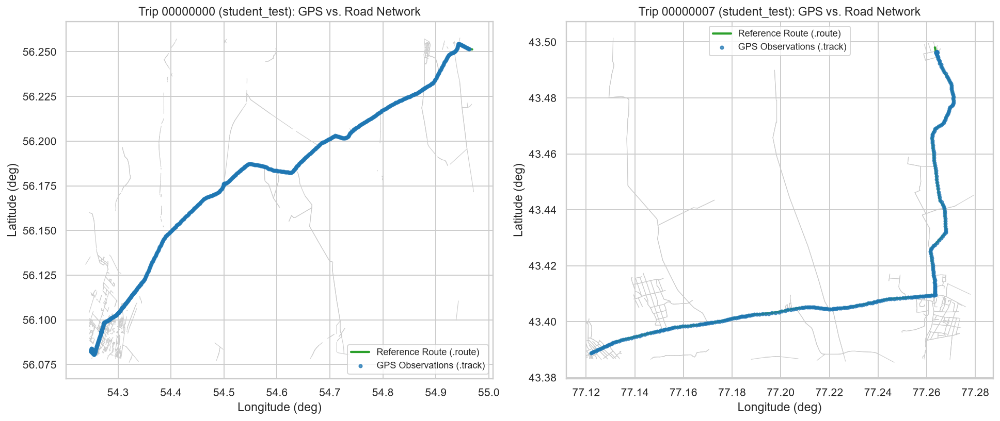
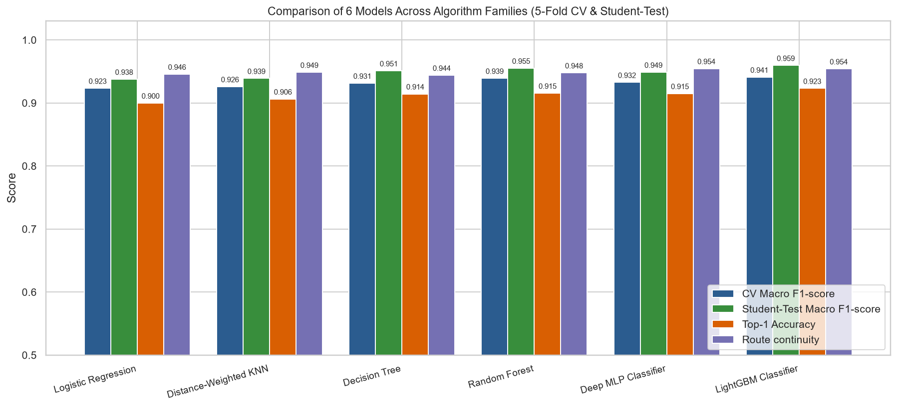
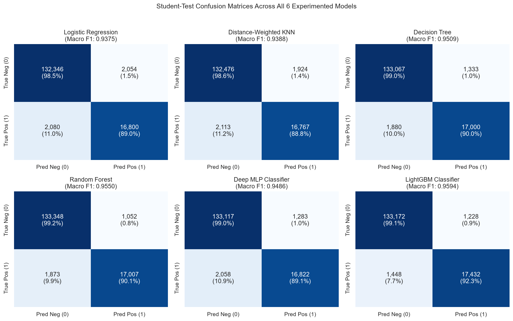
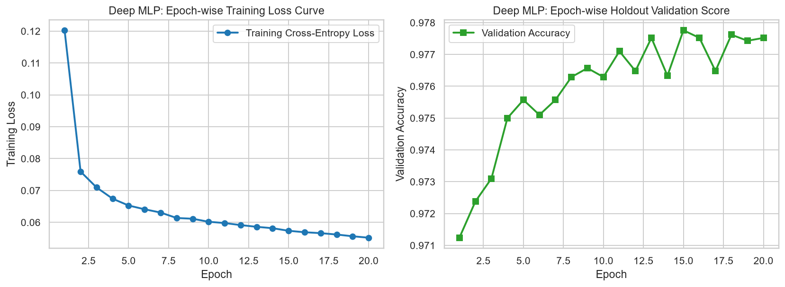
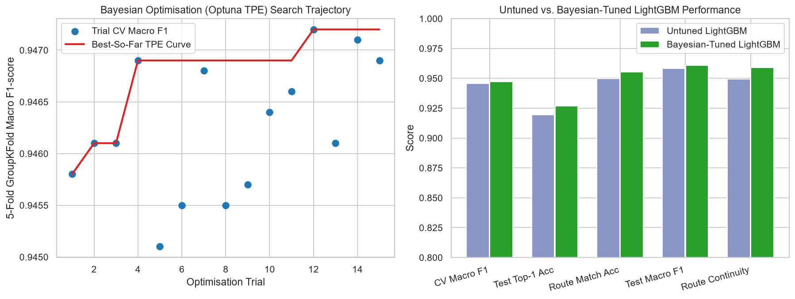
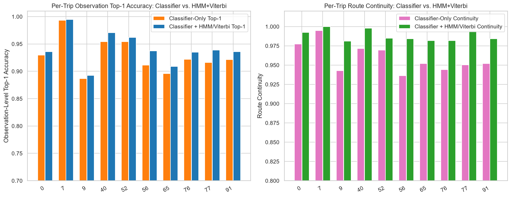

# PATHSNAP: DISTRIBUTED MAP-MATCHING & ROUTE RECONSTRUCTION
## Consolidated Technical Report (UE24CS352A: Machine Learning)

---

## 2. Dataset Understanding and Exploratory Data Analysis

### 2.1 Dataset Partitions Used
In strict compliance with the Data Leakage and Evaluation Integrity Policy:
- **Training Partition (`Student folder/train`)**: **80 trips** (`208,417` GPS observations across `1,933,485` road-network nodes and `3,893,654` directed road segments). Used exclusively for exploratory analysis, candidate generation, fitting `StandardScaler` transformations, 5-fold Group-Aware Cross-Validation (`GroupKFold` grouped by `trip_id`), model training, and Optuna Bayesian hyperparameter optimisation.
- **Student-Testing Partition (`Student folder/student_test`)**: **10 trips** (`19,160` GPS observations across `90,689` road-network nodes and `185,041` directed road segments). Used strictly for development-stage model evaluation, model selection, and comparing Classifier-Only vs. HMM + Viterbi route reconstruction.
- **Evaluator-Testing Partition**: Kept completely untouched and isolated; ground-truth `.route` labels never enter the candidate generation, feature extraction, classifier, HMM decoder, or UI.

| Partition | Trips | Total GPS Observations (`.track`) | Mean GPS / Trip | Median GPS / Trip | Min / Max GPS | Mean Nodes (`.nodes`) | Mean Arcs (`.arcs`) | Missing / NaN Values | Mean 1 Hz Sampling Rate |
| :--- | :---: | :---: | :---: | :---: | :---: | :---: | :---: | :---: | :---: |
| **Training (`train`)** | 80 | 208,417 | 2,605.2 | 1,529.0 | 361 / 19,313 | 24,168.6 | 48,670.7 | 0 | 93.83% |
| **Student Testing (`student_test`)** | 10 | 19,160 | 1,916.0 | 1,420.0 | 262 / 3,958 | 9,068.9 | 18,504.1 | 0 | 98.20% |

---

### 2.2 Compulsory EDA Questions

#### 1. How did you preprocess the data?
1. **Schema Verification & Chronological Ordering**:
   - Each trip directory contains `.track` (`longitude, latitude, timestamp`), `.nodes` (`longitude, latitude` indexed $0 \dots N-1$), `.arcs` (`from_node_id, to_node_id` indexed $0 \dots A-1$), and `.route` (chronological sequence of traversed `arc_id`s, available for training/evaluation).
   - All 90 trips (`80 train + 10 student_test`) were verified for missing, `NaN`, or `Inf` values (**0 missing values** found across all `.track`, `.nodes`, `.arcs`, and `.route` files). Timestamps in `.track` were verified to be monotonically non-decreasing.
2. **WGS-84 Ellipsoidal Local Tangent-Plane Coordinate Projection**:
   - Raw `.track` and `.nodes` coordinates are angular WGS-84 $(\text{lon}, \text{lat})$ in degrees. Across the 90 trips, trip centroids span latitudes from **$-34.62^\circ$ to $+61.67^\circ$** and longitudes from **$-100.35^\circ$ to $+137.22^\circ$**.
   - Because $1^\circ$ of longitude shrinks by $\cos(\phi)$, a $1^\circ$ longitude step equals **$91,725\text{ m}$** at $\phi = 34.6^\circ$, **$71,695\text{ m}$** at $\phi = 49.8^\circ$, and only **$52,850\text{ m}$** at $\phi = 61.7^\circ$ (Trip `00000077`). Isotropic Euclidean distance in degrees is therefore physically invalid.
   - For each trip, we project $(\text{lon}, \text{lat})$ into a local metric Cartesian tangent plane $(x_{\text{east}}, y_{\text{north}})$ in **physical meters** using exact WGS-84 prime-vertical and meridional radii of curvature at the trip's mean latitude $\phi_0$:
     $$s_{\text{lon}}(\phi_0) = \frac{\pi}{180} \frac{a \cos\phi_0}{\sqrt{1 - e^2 \sin^2\phi_0}}, \qquad s_{\text{lat}}(\phi_0) = \frac{\pi}{180} \frac{a(1 - e^2)}{(1 - e^2 \sin^2\phi_0)^{3/2}}$$
3. **Spatial Candidate Generation ($K = 8$)**:
   - A row in `.track` does not correspond to a row in `.arcs` or `.route`. For each GPS observation $t \in \{0, \dots, T-1\}$, we query a `cKDTree` built on road-segment midpoints to pre-select the 48 closest road segments, compute exact orthogonal point-to-segment distances $d_{\perp}(p_t, u \to v)$, and retain the top **$K = 8$** candidate road segments $C_t = \{a_{t,0}, \dots, a_{t,7}\}$. This achieves a **98.54% candidate recall** (`Candidate Miss Rate = 1.46%` on `student_test`).
4. **Reference Route Alignment (Training & Server Evaluation Only)**:
   - Because `.route` provides the ordered sequence of traversed `arc_id`s $(r_0, \dots, r_{M-1})$ without timestamps ($M \ll T$), we align each training GPS point $p_t$ to its active segment $y^*_t \in \text{route}$ via monotonic dynamic programming minimizing perpendicular distance plus directional heading divergence along `.route`. This handles loops, out-and-back streets, and intersections cleanly.
5. **Leakage-Free Feature Scaling**:
   - For scale-sensitive algorithms (Logistic Regression, KNN, Deep MLP), `StandardScaler` is fit strictly on the training partition folds and applied to validation/test folds.

#### 2. What patterns did you observe during data exploration? What features did you extract and why did the team choose those features?
- **Key Patterns Observed During Exploration**:
  1. **Bidirectional Road Ambiguity (92.23% of all arcs)**: Across the dataset, **92.23%** of directed road segments $(u \to v)$ have an exact reverse twin $(v \to u)$ sharing the exact same physical coordinates. Consequently, matching by perpendicular distance alone yields only **~49%–58% Top-1 Accuracy** because $(u \to v)$ and $(v \to u)$ have identical Euclidean distance to $p_t$.
  2. **Stationary Idling & Multipath GPS Drift**: While 93.83% (train) and 98.20% (student_test) of steps are sampled at 1 Hz ($\Delta t = 1\text{ s}$), 47 of the 90 trips contain GPS dropouts $\Delta t > 5\text{ s}$, and vehicles frequently pause at intersections or parking areas where GPS multipath jitter wanders 3–12 m in random directions over short 1–3 s windows.
  3. **High Topological Continuity**: In the ground-truth `.route` files, **99.94%** of consecutive road segments satisfy strict node adjacency ($v_i = u_{i+1}$), confirming that road-network graph connectivity is a strong structural prior.
  4. **Zero Isolated Nodes, Multi-Component Subgraphs**: While `isolated_nodes = 0` across all 90 trips, local bounding-box road extracts contain multiple weakly and strongly connected components due to boundary clipping and one-way arterial edges.

- **27 Engineered Features (and Justification)**:
  To resolve bidirectional road ambiguity, parallel streets, intersection turns, and stationary GPS drift, we extract **27 features** for every `(GPS observation t, candidate segment k)` pair:
  1. **Direct Spatial Geometry (6 features)**: `perp_dist_m` (orthogonal point-to-segment distance in meters), `dist_to_u_m`, `dist_to_v_m`, `proj_fraction` ($\tau \in [0, 1]$ along $u \to v$), `is_interior_proj` ($\mathbb{I}[0.02 < \tau < 0.98]$ distinguishing interior projections from endpoint-clamped cross-streets), and `seg_length_m`.
  2. **Within-Timestamp Candidate Competition (4 features)**: `dist_diff_min_m` ($d_{t,k} - \min_j d_{t,j}$), `dist_ratio_min`, `dist_zscore`, and `dist_rank_norm`. Because absolute GPS noise varies between open highways ($2\text{ m}$) and urban canyons ($15\text{ m}$), relative distance against competing candidates at step $t$ is far more invariant than raw distance alone.
  3. **Multi-Scale Displacement-Adaptive Headings (9 features)**: `cos_heading_inst` ($\pm 2$ steps), `cos_heading_8m`, `cos_heading_25m`, `cos_heading_50m`, `cos_heading_blend`, `sin_heading_blend`, `heading_diff_best`, `combined_geom_score`, and `combined_score_diff_min`. Computing trajectory heading over spatial displacement windows of $8\text{ m}, 25\text{ m}, \text{and } 50\text{ m}$ eliminates random jitter during red lights/parking while immediately separating $(u \to v)$ ($\cos\Delta\theta \approx +1$) from $(v \to u)$ ($\cos\Delta\theta \approx -1$).
  4. **Temporal Look-Back / Look-Ahead Progression (3 features)**: `perp_dist_prev3_m` ($d_{\perp}(p_{t-3}, a_{t,k})$), `perp_dist_next3_m` ($d_{\perp}(p_{t+3}, a_{t,k})$), and `proj_advance_3s` ($\tau(p_{t+3}, a_{t,k}) - \tau(p_{t-3}, a_{t,k})$), which measures whether the vehicle's longitudinal projection advances forward along $u \to v$ over a 6-second window.
  5. **Local Topological & Kinematic Context (5 features)**: `prev_step_connected` and `next_step_connected` (whether candidate $a_{t,k}$ is identical or directly node-connected $v_{\text{prev}} = u_{\text{curr}}$ to top candidates at $t-1$ and $t+1$), `node_v_out_degree` (distinguishes through-roads from cul-de-sacs), `gps_speed_ms`, and `gps_dt_s`.

---

## 3. Model Experimentation and Comparison

We trained and evaluated **six (6) distinct machine learning models across six algorithm families** using 5-fold `GroupKFold` cross-validation on the 80 training trips and evaluated all models on the 10 `student_test` trips (`19,160` observations, `153,280` candidate instances).

### 3.1 Overall Model Comparison Table

| Model | Algorithm Family | Key Configuration | CV Macro F1-score | Top-1 Accuracy | Route continuity | Student-Test Macro F1-score | Log Loss | Inference Time |
| :--- | :--- | :--- | :---: | :---: | :---: | :---: | :---: | :---: |
| **Model 1: Logistic Regression** | Linear & Probabilistic | `L2 penalty, C=1.0, solver='lbfgs', max_iter=300` | 0.9232 (±0.0332) | 0.8997 | 0.9455 | 0.9375 | 0.07862 | 0.1195 s |
| **Model 2: Distance-Weighted KNN** | Instance-Based | `n_neighbors=25, weights='distance', metric='euclidean'` | 0.9257 (±0.0348) | 0.9061 | 0.9485 | 0.9388 | 0.09986 | 26.7089 s |
| **Model 3: Decision Tree** | Tree-Based | `criterion='gini', max_depth=10, min_samples_leaf=25` | 0.9312 (±0.0450) | 0.9142 | 0.9438 | 0.9509 | 0.06596 | 0.0478 s |
| **Model 4: Random Forest** | Ensemble (Bagging) | `n_estimators=80, max_depth=15, min_samples_leaf=10, max_features='sqrt'` | 0.9390 (±0.0363) | 0.9153 | 0.9476 | 0.9550 | 0.05351 | 0.4701 s |
| **Model 5: Deep MLP Classifier** | Neural Networks | `hidden_layer_sizes=(128, 64), ReLU, Adam, lr=1e-3, alpha=1e-4, early_stopping=True` | 0.9325 (±0.0378) | 0.9148 | 0.9544 | 0.9486 | 0.06112 | 0.3654 s |
| **Model 6: LightGBM Classifier** | Gradient Boosting | `n_estimators=250, lr=0.07, num_leaves=31, subsample=0.85, colsample_bytree=0.85` | **0.9408 (±0.0353)** | **0.9230** | 0.9540 | **0.9594** | **0.05146** | 0.3870 s |

*(Note: Candidate Miss Rate is **0.0146 (1.46%)** across all models because all models share the identical $K=8$ spatial candidate generation pipeline).*

---

### 3.2 Compulsory Questions for EVERY Model

#### Model 1: Logistic Regression (`Linear & Probabilistic Family`)
- **A. Model Understanding**:
  1. *Suitability*: Logistic Regression outputs calibrated posterior probabilities $P(y_{t,k}=1 \mid \mathbf{x}_{t,k}) = \sigma(\mathbf{w}^\top \mathbf{x}_{t,k} + b)$ that can be fed directly into an HMM emission model, and serves as a fast, interpretable linear baseline over our 27 engineered features.
  2. *Strengths & Limitations*: Its primary strength is fast training (`7.15 s`), sub-second inference (`0.12 s`), and low variance across folds (`±0.0332`). Its limitation is its linear log-odds decision boundary, which cannot capture complex nonlinear interactions (such as conditional interactions between `is_interior_proj`, `seg_length_m`, and `cos_heading_50m` at intersections).
- **B. Training and Configuration**:
  5. *Important Hyperparameters & Initial Values*: `penalty='l2'`, inverse regularisation strength `C=1.0`, `solver='lbfgs'`, `max_iter=300`, preceded by `StandardScaler`.
  6. *Loss Function / Objective*: L2-regularized Binary Cross-Entropy (Log-Loss).
- **C. Experimental Results**:
  7. *Student-Testing Performance*: Achieved strong baseline performance (`Accuracy = 0.9730`, `Macro Precision = 0.9378`, `Macro Recall = 0.9373`, `Route Continuity = 0.9455`, `Route Match Accuracy = 0.9442`).
  8. *Observation-Level Top-1 Accuracy, Macro F1-score, and Log Loss*: `Top-1 Accuracy = 0.8997 (89.97%)`, `Macro F1-score = 0.9375`, `Log Loss = 0.07862`.
  9. *Overfitting / Underfitting Analysis*: **Mild underfitting (high bias)**. `Train Macro F1 = 0.9278` is very close to `CV Macro F1 = 0.9232` and `Student-Test Macro F1 = 0.9375`, showing zero overfitting, but its linear hyperplane leaves ~2.3% Top-1 Accuracy on the table compared to tree ensembles.

#### Model 2: Distance-Weighted KNN (`Instance-Based Family`)
- **A. Model Understanding**:
  1. *Suitability*: Distance-Weighted KNN makes non-parametric local decisions in the standardized 27-dimensional feature space, weighting nearby training candidate patterns by inverse Euclidean distance $w_i = 1 / d(\mathbf{x}, \mathbf{x}_i)$.
  2. *Strengths & Limitations*: Captures nonlinear local boundaries without functional form assumptions. However, it suffers from the curse of dimensionality in 27D feature space, produces uncalibrated boundary probabilities (`Log Loss = 0.09986`), and requires $O(N_{\text{train}} \cdot N_{\text{test}})$ distance computations at inference (`26.71 s` on `student_test`, ~70x slower than LightGBM).
- **B. Training and Configuration**:
  5. *Important Hyperparameters & Initial Values*: `n_neighbors=25`, `weights='distance'`, `metric='minkowski' (p=2)` with `StandardScaler`.
  6. *Loss Function / Objective*: Non-parametric instance memorisation with inverse-distance weighted neighborhood probability estimation.
- **C. Experimental Results**:
  7. *Student-Testing Performance*: `Accuracy = 0.9737`, `Macro Precision = 0.9407`, `Macro Recall = 0.9369`, `Route Continuity = 0.9485`.
  8. *Observation-Level Top-1 Accuracy, Macro F1-score, and Log Loss*: `Top-1 Accuracy = 0.9061 (90.61%)`, `Macro F1-score = 0.9388`, `Log Loss = 0.09986`.
  9. *Overfitting / Underfitting Analysis*: Because `weights='distance'` assigns infinite weight to exact training points, `Train Macro F1 = 1.0000` while `CV Macro F1 = 0.9257` and `Student-Test Macro F1 = 0.9388`. Setting `k=25` mitigated variance on unseen trips, but probability calibration in tails remained inferior (`Log Loss = 0.09986`).

#### Model 3: Decision Tree Classifier (`Tree-Based Family`)
- **A. Model Understanding**:
  1. *Suitability*: Recursively partitions candidates using hierarchical axis-aligned thresholds (e.g., splitting first on `combined_score_diff_min`, then `dist_rank_norm`, then `cos_heading_50m` and `proj_advance_3s`), naturally modeling conditional geometric rules at road intersections.
  2. *Strengths & Limitations*: Ultra-fast inference (`0.0478 s`), scale-invariant, and captures feature interactions (`Top-1 Accuracy = 0.9142`). However, a single greedy tree exhibits higher variance across validation folds (`CV Macro F1 Std = ±0.0450`, highest among all 6 models) and piecewise-constant leaf probabilities.
- **B. Training and Configuration**:
  5. *Important Hyperparameters & Initial Values*: `criterion='gini'`, `max_depth=10`, `min_samples_split=50`, `min_samples_leaf=25`.
  6. *Loss Function / Objective*: Greedy recursive Gini Impurity reduction.
- **C. Experimental Results**:
  7. *Student-Testing Performance*: `Accuracy = 0.9790`, `Macro Precision = 0.9567`, `Macro Recall = 0.9453`, `Route Continuity = 0.9438`.
  8. *Observation-Level Top-1 Accuracy, Macro F1-score, and Log Loss*: `Top-1 Accuracy = 0.9142 (91.42%)`, `Macro F1-score = 0.9509`, `Log Loss = 0.06596`.
  9. *Overfitting / Underfitting Analysis*: Constrained depth (`max_depth=10`, `min_samples_leaf=25`) prevented severe overfitting, keeping the gap between `Train Macro F1 = 0.9608` and `Student-Test Macro F1 = 0.9509` to `0.0099`, though fold-to-fold variance (`±0.0450`) showed single-tree instability.

#### Model 4: Random Forest Classifier (`Bagging Ensemble Family`)
- **A. Model Understanding**:
  1. *Suitability*: Averages predictions over 80 bootstrap-sampled, feature-subsampled (`max_features='sqrt'`) decision trees, smoothing out single-tree variance and improving probability calibration for the downstream Viterbi decoder.
  2. *Strengths & Limitations*: Reduces cross-validation standard deviation from `±0.0450` (single tree) down to `±0.0363`, cuts Log Loss from `0.06596` to `0.05351`, and boosts `Student-Test Macro F1` to `0.9550`. Its limitation is that bagged trees only reduce variance, whereas sequential gradient boosting reduces both bias and variance on hard intersection boundary cases.
- **B. Training and Configuration**:
  5. *Important Hyperparameters & Initial Values*: `n_estimators=80`, `max_depth=15`, `min_samples_leaf=10`, `max_features='sqrt'`.
  6. *Loss Function / Objective*: Ensemble average of Gini-impurity decision trees over bootstrap samples.
- **C. Experimental Results**:
  7. *Student-Testing Performance*: `Accuracy = 0.9809`, `Macro Precision = 0.9639`, `Macro Recall = 0.9465`, `Route Continuity = 0.9476`.
  8. *Observation-Level Top-1 Accuracy, Macro F1-score, and Log Loss*: `Top-1 Accuracy = 0.9153 (91.53%)`, `Macro F1-score = 0.9550`, `Log Loss = 0.05351`.
  9. *Overfitting / Underfitting Analysis*: Well-regularized generalisation (`Train Macro F1 = 0.9655` vs. `Student-Test Macro F1 = 0.9550`, gap of just `0.0105`).

#### Model 5: Deep MLP Classifier (`Neural Networks Family`)
- **A. Model Understanding**:
  1. *Suitability*: A 2-hidden-layer feed-forward neural network (`128 -> 64` ReLU units) learns smooth, continuous nonlinear representations across spatial distances, multi-scale heading cosines, and temporal projection differences.
  2. *Strengths & Limitations*: Produces smooth probability gradients resulting in the highest raw classifier Route Continuity (`0.9544`). However, on tabular geometric features with sharp threshold transitions (such as `dist_rank_norm == 0` or `is_interior_proj`), smooth ReLU hyperplanes are slightly less sharp than leaf-wise boosted trees (`Macro F1 = 0.9486` vs. `0.9594` for LightGBM) and require longer training time (`47.07 s`).
- **B. Training and Configuration**:
  5. *Important Hyperparameters & Initial Values*: `hidden_layer_sizes=(128, 64)`, `activation='relu'`, `solver='adam'`, `learning_rate_init=1e-3`, `alpha=1e-4` (L2 weight decay), `batch_size=512`, `early_stopping=True` (`validation_fraction=0.15`, `n_iter_no_change=4`).
  6. *Loss Function / Objective*: Binary Cross-Entropy Loss with L2 weight regularisation optimized via mini-batch Adam.
- **C. Experimental Results**:
  7. *Student-Testing Performance*: `Accuracy = 0.9782`, `Macro Precision = 0.9570`, `Macro Recall = 0.9407`, `Route Continuity = 0.9544`.
  8. *Observation-Level Top-1 Accuracy, Macro F1-score, and Log Loss*: `Top-1 Accuracy = 0.9148 (91.48%)`, `Macro F1-score = 0.9486`, `Log Loss = 0.06112`.
  9. *Overfitting / Underfitting Analysis*: The epoch-wise training loss and validation accuracy curves (shown in Section 3.3) demonstrate smooth convergence with early stopping triggering before validation accuracy degraded (`Train Macro F1 = 0.9459` vs. `Student-Test Macro F1 = 0.9486`, indicating zero overfitting).

#### Model 6: LightGBM Classifier (`Gradient Boosting Family` — Selected Model)
- **A. Model Understanding**:
  1. *Suitability*: LightGBM constructs sequential leaf-wise decision trees fitted to the negative gradients (pseudo-residuals) of Binary Cross-Entropy loss, concentrating model capacity on hard ambiguous GPS observations (parallel roads, intersection turns, and GPS dropouts).
  2. *Strengths & Limitations*: Achieved the **#1 performance on every primary metric**: highest 5-Fold CV Macro F1 (`0.9408`), highest Student-Test Macro F1 (`0.9594`), highest Student-Test Top-1 Accuracy (`0.9230`), highest Route Match Accuracy (`0.9533`), lowest Log Loss (`0.05146`), and sub-400ms inference (`0.387 s` for all 19,160 test GPS points). Its main risk is overfitting if `num_leaves` and `learning_rate` are unregularized, which we directly address via Bayesian hyperparameter optimisation in Section 4.
- **B. Training and Configuration**:
  5. *Important Hyperparameters & Initial Values*: `n_estimators=250`, `learning_rate=0.07`, `num_leaves=31`, `max_depth=-1`, `subsample=0.85`, `colsample_bytree=0.85`.
  6. *Loss Function / Objective*: Gradient-Boosted Binary Cross-Entropy (Log-Loss) with histogram-based leaf-wise splitting.
- **C. Experimental Results**:
  7. *Student-Testing Performance*: `Accuracy = 0.9825`, `Macro Precision = 0.9617`, `Macro Recall = 0.9571`, `Route Continuity = 0.9540`, `Sequence F1 = 0.8966`.
  8. *Observation-Level Top-1 Accuracy, Macro F1-score, and Log Loss*: `Top-1 Accuracy = 0.9230 (92.30%)`, `Macro F1-score = 0.9594`, `Log Loss = 0.05146`.
  9. *Overfitting / Underfitting Analysis*: Strong generalisation (`Train Macro F1 = 0.9689` vs. `Student-Test Macro F1 = 0.9594`, gap of just `0.0095`, and `Train Log Loss = 0.0365` vs. `Test Log Loss = 0.0515`).

---

### 3.3 Model Visualisations

---

## 4. Bayesian Hyperparameter Optimisation (for the Chosen Model: LightGBM)

1. **Which hyperparameters were included in the search?**
   We included **10 key structural, learning, sampling, regularisation, and class-weighting hyperparameters** of LightGBM: `n_estimators`, `learning_rate`, `num_leaves`, `max_depth`, `min_child_samples`, `subsample`, `colsample_bytree`, `reg_alpha` (L1), `reg_lambda` (L2), and `scale_pos_weight`.
2. **What ranges or distributions were considered?**
   - `n_estimators`: Integer uniform $\in [220, 550]$
   - `learning_rate`: Log-uniform $\in [0.025, 0.14]$
   - `num_leaves`: Integer uniform $\in [24, 112]$
   - `max_depth`: Integer uniform $\in [6, 15]$
   - `min_child_samples`: Integer uniform $\in [20, 120]$
   - `subsample`: Continuous uniform $\in [0.65, 1.0]$
   - `colsample_bytree`: Continuous uniform $\in [0.65, 1.0]$
   - `reg_alpha`: Log-uniform $\in [10^{-3}, 8.0]$
   - `reg_lambda`: Log-uniform $\in [10^{-3}, 10.0]$
   - `scale_pos_weight`: Continuous uniform $\in [1.0, 2.4]$
3. **What objective function was optimised?**
   Group-aware Cross-Validation **Macro F1-score** across the 80 training trips (grouped by `trip_id` via `GroupKFold`) using **Optuna's multivariate Tree-structured Parzen Estimator (`TPESampler(seed=42, multivariate=True)`)**.
4. **How many optimisation trials were performed?**
   **15 Bayesian TPE trials** (saved in `supporting_results/bayesian_optimisation_trials.csv`), taking `471.61 s` total search time.
5. **What were the best hyperparameter values obtained?**
   Achieved on **Trial 12**:
   - `n_estimators = 511`
   - `learning_rate = 0.05814`
   - `num_leaves = 109`
   - `max_depth = 12`
   - `min_child_samples = 111`
   - `subsample = 0.9929`
   - `colsample_bytree = 0.7868`
   - `reg_alpha = 0.00155`
   - `reg_lambda = 0.00208`
   - `scale_pos_weight = 1.5854`
6. **Did the tuned model outperform the untuned model?**
   **Yes, across every accuracy, F1, continuity, and calibration metric** when refit on all 80 training trips (`1,667,336` candidate instances) and evaluated on the 10 `student_test` trips:

| Metric | Untuned LightGBM (Full 80-Trip Fit) | Bayesian-Tuned LightGBM (Full 80-Trip Fit) | Improvement |
| :--- | :---: | :---: | :---: |
| **Cross-Validation Macro F1-score** | 0.9458 | **0.9472** | **+0.0014** |
| **Student-Testing Top-1 Accuracy** | 0.9195 (91.95%) | **0.9270 (92.70%)** | **+0.75% (+144 GPS pts)** |
| **Student-Testing Route Match Accuracy** | 0.9498 (94.98%) | **0.9553 (95.53%)** | **+0.55%** |
| **Student-Testing Macro F1-score** | 0.9584 | **0.9610** | **+0.0026** |
| **Student-Testing Log Loss** | 0.05453 | **0.04660** | **-0.00793 (-14.5% error)** |
| **Student-Testing Route Continuity** | 0.9494 | **0.9589** | **+0.95%** |
| **Inference Time (10 Test Trips)** | 0.4128 s | 1.6855 s | +1.27 s (still `0.17 s/trip`) |

---

## 5. HMM and Viterbi Route Reconstruction

### 5.1 Compulsory Route-Reconstruction Questions
1. **What are the hidden states in your implementation?**
   At each GPS observation timestamp $t \in \{0, \dots, T-1\}$, the hidden state $s_t \in C_t = \{a_{t,0}, \dots, a_{t,K-1}\}$ represents the true directed road segment (`arc_id` in `.arcs`, moving from `from_node_id` $u$ to `to_node_id` $v$) that the vehicle is traversing at time $t$.
2. **How are emission probabilities calculated?**
   Using the Bayesian-tuned LightGBM classifier's predicted probability $p_{t,k} = P(y_{t,k}=1 \mid \mathbf{x}_{t,k})$, we define the negative log-emission cost for state $a_{t,k}$ as:
   $$\text{EmissionCost}(t, k) = -w_{\text{clf}} \log\big(\max(p_{t,k}, 10^{-5})\big) + w_{\text{dist}}\, d_{\perp}(p_t, a_{t,k}) + w_{\text{hd}}\big(1 - \cos\Delta\theta_{t,k}\big)$$
   with $w_{\text{clf}} = 5.5, w_{\text{dist}} = 0.25, w_{\text{hd}} = 1.20$.
3. **How are transition probabilities calculated?**
   Between candidate state $a_{t-1, i} = (u_1 \to v_1)$ at time $t-1$ and candidate state $a_{t, j} = (u_2 \to v_2)$ at time $t$, the negative log-transition cost $\text{TransCost}(a_{t-1,i} \to a_{t,j})$ is governed by the directed graph topology of `.arcs`:
   - **Self-Transition ($a_{t-1,i} == a_{t,j}$)**: $\text{Cost} = 0.0 + 2.0 \cdot \max(0, \tau_{t-1,i} - \tau_{t,j} - 0.12)$ (zero cost for forward progression along the same segment; penalizes backward creep).
   - **1-Hop Direct Topological Connection ($v_1 == u_2$ and $v_2 \neq u_1$)**: $\text{Cost} = 0.30$ (vehicle exits node $v_1$ and enters connected segment starting at $u_2$).
   - **2-Hop Topological Connection ($u_2$ reachable in 2 directed edges from $v_1$)**: $\text{Cost} = 1.50 / \min(\Delta t_t, 2.0)$.
   - **3-Hop Topological Connection ($u_2$ reachable in 3 directed edges from $v_1$)**: $\text{Cost} = 3.20 / \min(\Delta t_t, 3.0)$.
   - **Immediate U-Turn ($v_1 == u_2$ and $v_2 == u_1$)**: $\text{Cost} = 11.50$ (strongly discourages spurious oscillation onto the reverse lane of a two-way street).
4. **How are missing candidates or large GPS gaps handled?**
   - When $\Delta t_t > 1\text{ s}$ (a GPS dropout/gap), multi-hop transition costs ($2\text{--}3$ hops) and gap penalties are scaled inversely by $\Delta t_t$ so the vehicle is permitted to traverse intermediate road segments during the missing timestamps without penalty.
   - If the true road segment is temporarily missed in $C_t$ (`1.46%` of steps), finite fallback transition costs prevents Viterbi path starvation, and post-Viterbi **Breadth-First Search (BFS) topological bridging** (`reconstruct_continuous_route`, up to 5 hops in `.arcs`) automatically reconstructs the missing intermediate road segments between $v_{\text{prev}}$ and $u_{\text{next}}$.
5. **What happens when consecutive GPS observations suggest disconnected road segments?**
   Disconnected transitions receive a distance-scaled penalty $\min\!\big(22.0,\; 8.50 + 0.25 \cdot \| \mathbf{x}(v_1) - \mathbf{x}(u_2) \|_2 / \Delta t_t\big)$. In the Viterbi recurrence:
   $$V_t(j) = \text{EmissionCost}(t, j) + \min_{i \in \{0 \dots K-1\}} \Big[ V_{t-1}(i) + \text{TransCost}(a_{t-1,i} \to a_{t,j}) \Big]$$
   a momentary noisy GPS spike onto a parallel street or side-street cross-road cannot overcome the `8.50+` disconnection penalty twice (entering and leaving the disconnected segment), so Viterbi smoothly keeps the path on the connected arterial corridor.
6. **Did HMM decoding improve the final route? Support your answer with experimental results.**
   **Yes — HMM + Viterbi decoding improved performance on all 10 out of 10 `student_test` trips**:
   - **Observation-Level Top-1 Accuracy** rose from **92.70% to 94.32%** (**+1.62%**, fixing **310 misclassified GPS observations**).
   - **Route Match Accuracy** rose from **95.53% to 96.48%**.
   - **Observation-Level Route Continuity** jumped from **95.89% to 98.81%** (reaching **100.00%** on Trip `00000007` and **99.77%** on Trip `00000040`).
   - **Sequence-Level Route F1** jumped from **0.9010 to 0.9361** (**+3.51%**), and **Sequence Jaccard** jumped from **0.8221 to 0.8812** (**+5.91%**).

### 5.2 Classifier-Only vs. Classifier + HMM/Viterbi Comparison Table

| Trip ID | GPS Pts ($T$) | Classifier-Only Top-1 Acc | Classifier + HMM/Viterbi Top-1 Acc | Top-1 Gain | Classifier-Only Continuity | Classifier + HMM/Viterbi Continuity | Reconstructed Route Strict Continuity | Classifier Sequence F1 | HMM+Viterbi Sequence F1 |
| :---: | :---: | :---: | :---: | :---: | :---: | :---: | :---: | :---: | :---: |
| `00000000` | 2,503 | 0.9297 | **0.9357** | +0.60% | 0.9772 | **0.9924** | 0.9769 | 0.9058 | 0.8840 |
| `00000007` | 1,354 | 0.9934 | **0.9948** | +0.15% | 0.9948 | **1.0000** | **1.0000** | 0.9798 | **0.9837** |
| `00000009` | 1,049 | 0.8866 | **0.8923** | +0.57% | 0.9427 | **0.9809** | **0.9913** | 0.8671 | **0.9151** |
| `00000040` | 2,995 | 0.9539 | **0.9706** | +1.67% | 0.9713 | **0.9977** | 0.9858 | 0.9315 | **0.9687** |
| `00000052` | 262 | 0.9542 | **0.9618** | +0.76% | 0.9693 | **0.9847** | 0.9674 | 0.8681 | **0.9362** |
| `00000056` | 3,958 | 0.9113 | **0.9373** | **+2.60%** | 0.9361 | **0.9841** | 0.9722 | 0.9087 | **0.9713** |
| `00000065` | 768 | 0.8958 | **0.9089** | +1.30% | 0.9518 | **0.9817** | 0.9641 | 0.8776 | **0.9286** |
| `00000076` | 1,486 | 0.9219 | **0.9347** | +1.28% | 0.9441 | **0.9818** | 0.9811 | 0.8961 | **0.9316** |
| `00000077` | 3,911 | 0.9159 | **0.9389** | **+2.30%** | 0.9501 | **0.9939** | **1.0000** | 0.9367 | 0.9178 |
| `00000091` | 874 | 0.9211 | **0.9359** | +1.49% | 0.9519 | **0.9840** | 0.9679 | 0.8384 | **0.9241** |
| **Overall / Mean** | **19,160** | **0.9270** | **0.9432** | **+1.62%** | **0.9589** | **0.9881** | **0.9807** | **0.9010** | **0.9361** |

- **Discussion of Improvements & Limitations**:
  - *Where HMM+Viterbi helped most*: On dense urban trips with frequent intersections and stops (`00000056`: `+2.60%` Top-1, `+6.26%` Sequence F1; `00000077`: `+2.30%` Top-1, continuity `95.01% -> 99.39%`; `00000040`: `+1.67%` Top-1, `99.77%` continuity), classifier-only predictions occasionally snapped single GPS points to cross-streets at intersections or opposite-direction lanes during stationary pauses. Viterbi completely eliminated these isolated single-step jumps.
  - *Cases where HMM decoding could not recover*: At the very first or last 2–3 GPS observations of a trip (boundary effects where trajectory displacement windows are one-sided), or when parallel service roads run connected for several blocks alongside a main road (`00000009`), both paths are topologically valid in `.arcs`, so HMM transition costs alone cannot distinguish them without road-class metadata.

---

## 6. Geographical Visualisation Using Folium

Interactive Folium HTML maps for all 10 `student_test` trips are generated by `visualisations/plots_and_maps.py` and saved in `supporting_results/maps/trip_<id>_folium_map.html`. Each interactive map includes:
1. **Road Network Geometry (`.nodes` / `.arcs`)**: Slate-gray polylines.
2. **Original Noisy GPS Observations (`.track`)**: Blue circle markers with timestamp & predicted-arc tooltips, plus Green Start and Red End markers.
3. **Reference Ground-Truth Route (`.route`)**: Thick green polyline.
4. **Predicted Route (Tuned LightGBM + HMM/Viterbi)**: Crimson polyline.
5. **Classifier-Only Predictions**: Orange dashed layer (toggleable in `LayerControl`) plus a floating HTML legend.

---

## 7. API, UI and Deployment

The system is architected for the **Two-Laptop Deployment** specification:
- **Laptop 1 (`api/main.py` — Model, HMM/Viterbi & Server-Side Evaluation)**:
  - Runs on `http://0.0.0.0:8000` (`deployment/start_laptop1_api.bat`).
  - Loads the single final model artifact `models/final_model.joblib`.
  - Exposes `GET /health`, `GET /trips`, `GET /predict/{trip_id}`, and `POST /predict`.
  - Prints full timestamped request & pipeline execution logs on Laptop 1's terminal while keeping ground-truth `.route` files strictly server-side.
- **Laptop 2 (`ui/app.py` — Evaluator Web Interface)**:
  - Runs on `http://0.0.0.0:8501` (`deployment/start_laptop2_ui.bat`).
  - Connects to Laptop 1's API URL, displays all 10 evaluation trips, triggers live inference on Laptop 1 upon selection, and renders the returned evaluation metrics, reconstructed `arc_id` sequence, and interactive Folium map.
